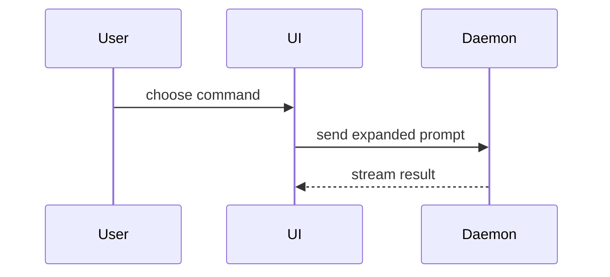

撰写 PR 正文时使用以下模板：

```markdown
## Summary

<示意图、diff 草图或树状图>

## Evidence

- **Before:** <截图 / 输出 / 失败的测试运行记录>
  **After:** <截图 / 输出 / 通过的测试运行记录>

## Merge Danger

**Door:** <单向门（one-way）或双向门（two-way）>

<可选：补充说明>

**Blast Radius:** <用一个词描述爆炸半径>

<可选：合并可能带来的影响>
```

## 各小节规范

跳过所有铺垫寒暄，文字保持简短。统一使用项目 `GLOSSARY.md` 中的领域语言。

### Summary（摘要）

选择能把核心要点讲清楚的最小化视图。

- 用伪代码展示逻辑或算法：

```text
on(save)
  if content is unchanged
    return cached result
  write new content
  return fresh result
```

- 用调用树展示运行时控制流：

```text
submitForm
  createSession
    persistPrompt
    launchAgent
  navigateToSession
```

- 用组件树展示 UI 结构，带上关键的状态与模块边界：

```text
<SessionPage> (apps/example/src/routes/session.tsx)
  useSessionEvents()
  <SessionToolbar>
    <RunSkillButton> (packages/ui)
```

- 用浅层文件树展示文件职责或大范围重构：

```text
src/
├── commands/       # parses user actions
├── sessions/       # owns session state
└── transport/      # sends API requests
```

- 用 Mermaid 展示组件交互、控制流或数据流：



- 当重点在于“改动了什么”且周围结构原本就存在时使用 `diff`，并让 diff 形态贴合主题。

组件变更示例：

```diff
 <SessionPage>
   useSessionEvents()
   <SessionToolbar>
+    <RunSkillButton />
   <SessionTimeline>
+    <SkillResultCard />
```

文件布局变更示例：

```diff
 src/
 ├── commands/
+│   └── show-me.ts       # expands the slash command
 ├── sessions/
-└── transport.ts
+└── transport/
+    ├── client.ts
+    └── stream.ts
```

调用树或调用栈变更示例：

```diff
 submitForm
   createSession
     persistPrompt
+    expandSkillMention
     launchAgent
-  navigateToSession
+  navigateToSession
+    subscribeToEvents
```

状态或控制流变更示例：

```diff
 on(save)
-  write content
+  if content is unchanged
+    return cached result
+  write new content
+  invalidate cache
```

- 当大部分内容都是新增的、省略上下文会掩盖归属或顺序关系、或者用户需要一个可直接复制的目标形状时，直接展示完整代码块：

```ts
function expandSkill(command: string): string {
  const skillName = command.slice(1);
  return `use the ${skillName} skill`;
}
```

#### 选用建议

把每个可视化片段紧挨着它所支撑的短文本放置。只保留回答当前问题或当前讨论分支决策所需的调用、文件、props、状态与边界。

可以只用一种，也可以组合几种，但不太可能全用上。凭判断取舍，不要让评审者信息过载。

### Evidence（验证证据）

证明改动确实生效的具体证据，展示改动前后对比。

当环境具备条件且改动涉及视觉表现时，截图是 S 级证据。

基于执行的证据是 A 级证据：测试结果、控制台输出。用伪代码或真实片段展示原本失败、如今通过的具体测试。

### Merge Danger（合并风险）

说明这次合入是**单向门**还是**双向门**。双向门可以退回，单向门不能。回滚成本低的 PR 风险更低；涉及破坏性操作或难以逆转决策的改动属于单向门。

**Blast Radius（爆炸半径）**指本次 PR 引入改动的潜在影响面。综合考虑各种可能性，例如布局偏移、对下游调用方的破坏、移动端响应式适配等。