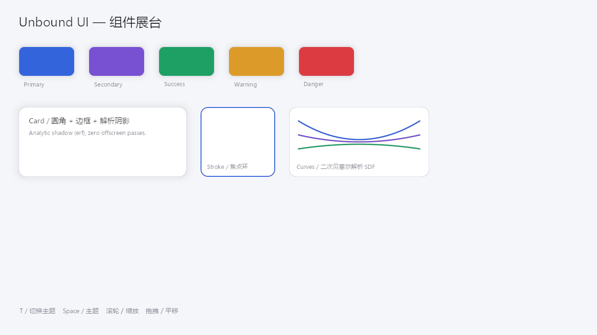
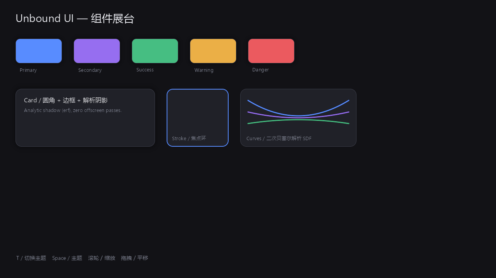

# 组件展台：一次看全所有图元

> **实现状态**：`已落地`
>
> | | |
> | :--- | :--- |
> | **源码** | `apps/showcase/src/{main,gallery}.rs`、`apps/showcase/tests/gallery.rs` |
> | **关键类型** | `Gallery`、`Palette`、`Labels`、`Showcase` |
> | **测试** | `apps/showcase/tests/gallery.rs`；渲染正确性由 `crates/unbound-gpu` 的像素断言覆盖 |

`apps/showcase` 是引擎的**可视验收台**：一个真实开窗的 Vulkan 程序，把引擎能画
的每一种图元都摆在一屏里。启动它不需要任何资产、不需要配置文件，窗口一开就能
看到圆角矩形、边框、解析阴影、描边环、贝塞尔曲线、MTSDF 字形与双主题配色。



## 为什么需要它

引擎此前的示例程序 `apps/gallery` 是一个**纯控制台**程序：它只打印测量数字，
不产生任何画面。GPU crate 本身是离屏渲染器，`unbound-gpu` 的图集槽位还绑在
1×1 的哑纹理上——文字甚至无法采样。于是「引擎到底画不画得对」这个问题，
在窗口里是看不到答案的。

展台把这条链路补齐了：

| 环节 | 落地位置 |
| :--- | :--- |
| Vulkan surface 与 swapchain | `crates/unbound-gpu/src/surface.rs` |
| 真实 bindless 图集与上传通路 | `crates/unbound-gpu/src/atlas.rs` |
| 窗口化呈现（acquire → render → present） | `apps/showcase/src/main.rs` |
| 图元排布与主题配色 | `apps/showcase/src/gallery.rs` |

## 跑起来

```bash
cargo run -p showcase --release
```

窗口里的操作：

| 输入 | 行为 |
| :--- | :--- |
| `T` / `Space` | 在亮色与暗色主题之间切换 |
| 滚轮 | 以视口中心为锚点缩放（0.25× – 8×） |
| 左键拖拽 | 平移画布 |

### 无头模式

CI 与文档流水线没有窗口，`--shot` 会把**同一份场景**渲染到离屏目标并写成 PNG：

```bash
cargo run -p showcase --release -- --shot shot.png          # 亮色
cargo run -p showcase --release -- --shot shot.png --dark   # 暗色
```



这让「渲染结果」变成可以进版本库、可以逐像素比对的东西，而不是只能靠人眼看。

## 场景里摆了什么

`gallery.rs` 的 `build()` 用引擎自己的公开 API 拼出一屏场景，每个元素都对应
一类图元：

| 元素 | 覆盖的引擎能力 |
| :--- | :--- |
| 页面背景 | 全屏圆角矩形、z 序、反向 Z 深度 |
| 五个色块 | 填充 + 1 px 边框 + `erf` 解析阴影 |
| 白色卡片 | 圆角 + 边框 + 阴影，圆角半径 16 |
| 蓝色焦点环 | `PrimType::Stroke` 的描边环 |
| 三条彩线 | 二次贝塞尔曲线的解析 SDF |
| 标题与各处标签 | 双图集 + MTSDF 字形采样 |
| 底部提示行 | 深色主题下的文字极性补偿 |

### 主题切换为什么是「零上传」

亮暗两套主题**共用同一套 token 槽位**，只有颜色表里的值不同。切换主题因此只
是一次 4 KiB 的颜色表写入——图元数据一个字节都不用动，这与
[正交缩放与主题切换](../02-ui/theme-and-zoom.md) 描述的机制一致。

| 槽位 | 含义 |
| ---: | :--- |
| 0 | 无（恒透明，描边图元的填充槽用它） |
| 1 | 阴影色（引擎的 `SHADOW_TOKEN` 固定槽） |
| 2 | 页面背景 |
| 3 | 面板底色 |
| 4 | 面板边框 |
| 5 – 9 | primary / secondary / success / warning / danger |
| 10 / 11 | 正文 / 次要文字 |

## 展台暴露出的引擎缺陷

展台不是一个「装饰品」，它是这些缺陷的发现方式——每一个都对应一处真实修复：

| 症状 | 根因 | 修复 |
| :--- | :--- | :--- |
| 色块整体偏移 `pad` 像素 | 片元着色器把局部坐标又减了一次阴影扩张量 | `p = v_local` |
| 边框变成 14 px 的粗环、阴影不出现 | `unpackHalf2x16` 的分量顺序取反 | 按规范取低位在 `.x` |
| 面板被描边「顶穿」、文字底下出现暗块 | 不透明内核预通道给所有图元都写了深度 | 预通道只写不透明容器的内核矩形 |
| 焦点环完全不可见 | 描边分支取了填充槽的颜色 | 描边取边框槽的颜色 |
| 阴影看不见 | 阴影色被硬编码在 LUT 第 1 槽，展台却放在第 10 槽 | 统一槽位约定 |

---

**相关文档**：[Uber-Shader 与双通道深度](../01-graphics/uber-shader.md) ·
[解析解阴影](../01-graphics/shadow.md) · [工业级文字渲染](../01-graphics/text.md)

**返回**：[06-tooling](README.md) · [文档索引](../README.md)
