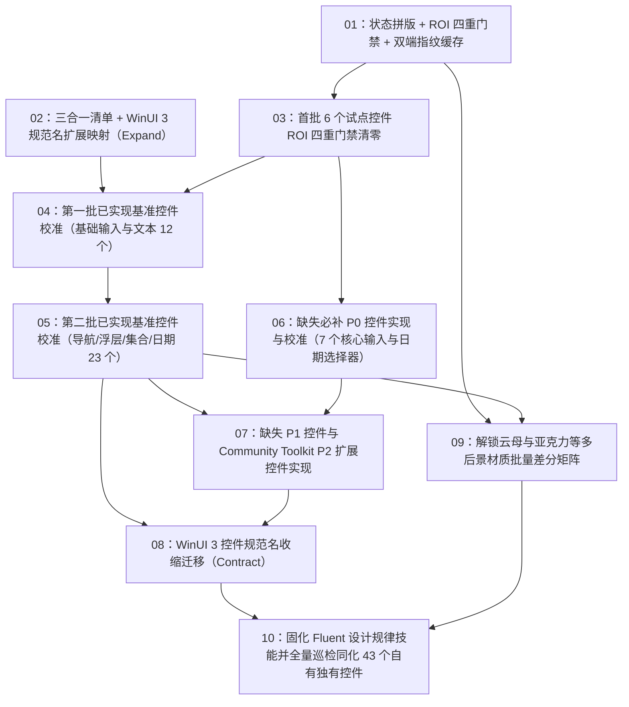

# WinUI 3 控件对齐与批量像素差分系统交接文档（Handoff & GitHub 上传指南）

## 1. 本次会话完成的改动概览

本次会话通过 `grill-with-docs`（`grilling` + `domain-modeling`）完成了 **WinUI 3 控件对齐体系、状态拼版批量截图、有效对比区（ROI）四重门禁、双端指纹缓存与 Fluent 设计规律技能** 的架构设计与代码/文档落地：

| 类别 | 文件路径 | 改动内容说明 |
| --- | --- | --- |
| **领域术语表** | `GLOSSARY.md` | 新增 6 个核心领域术语：**有效对比区、拼版图集、用例指纹、合成底板、基准对齐控件、自有独有控件** |
| **架构决策记录** | `docs/adr/0008-batched-roi-parity-and-control-taxonomy.md` | 记录状态拼版分片切图、ROI 四重门禁、双端指纹缓存、合成底板预留与三类控件清单分级策略 |
| **系统架构文档** | `docs/architecture/03-扩展系统（subsystems）/无头验证与展台（verification-and-showcase）.md` | 按五段式无代码符号规范更新架构图与说明，纳入状态拼版与有效对比区像素差分闭环 |
| **三合一控件清单** | `docs/winui3-control-inventory.md` | 完整梳理现有 **109 个目录组件**：包含 52 个 WinUI 3 基准对齐控件规范名映射、14 个 Community Toolkit 对齐控件、**18 个核心缺失必补（P0/P1）+ 6 个选补（P2）控件**，以及 **43 个 Unbound 自有独有控件** |
| **Fluent 设计规律技能** | `.agents/skills/fluent-control-design/SKILL.md`<br>`.agents/skills/fluent-control-design/REFERENCE.md` | 沉淀 WinUI 3 的薄纱表面阶梯（sRGB vs 线性 alpha 反解）、微描边/底边强调线、尺寸圆角阶梯、四态单源状态机与弹簧规律，并提供自有独有控件迁移巡检表 |
| **WinUI 3 参考截图宿主** | `tools/winui-reference/Catalog.cs`<br>`tools/winui-reference/CaptureWindow.xaml.cs`<br>`tools/winui-reference/README.md` | 支持按「控件 × 主题 × 后景」生成水平网格状态拼版（共享一次 350ms 动画收敛与单次 `RenderTargetBitmap`），自动按 `controlBounds + 16 DIP` 切出紧凑单图，支持 16 位 SHA-256 指纹增量缓存（`--no-cache` 强制刷新）与 `--backdrop solid|mica|mica_alt|acrylic|all` |
| **Unbound 像素差分引擎** | `apps/showcase/src/parity.rs`<br>`apps/showcase/src/png_diff.rs`<br>`apps/showcase/src/pages/parity_report.rs`<br>`apps/showcase/src/main.rs` | 引入 `ParitySession` 全局复用单 Vulkan 设备/渲染器/字形图集实例；新增 FNV-1a 64-bit 控件源码与调色板哈希缓存；将色差统计裁剪至 `union(reference_bbox, ours_bbox, controlBounds) + 2px` 的有效对比区（ROI），并执行四重门禁（包围盒、固有尺寸、ROI mean/p95、显著色差像素占比 `≤ 2%`） |

---

## 2. 本地应用 Patch 与上传 GitHub 操作步骤

由于沙盒环境无外网连接，所有修改已打包为标准的 Git 补丁包（位于附件压缩包 `unbound-ui-winui3-parity-patch.zip` 中）：

### 2.1 应用补丁并本地验证

在你的本地机器（具备 Rust 工具链、Vulkan 环境、.NET 8 SDK 与 GitHub CLI）仓库根目录下执行：

```powershell
# 1. 解压补丁包后应用 git patch（二选一：直接打格式化 commit 补丁，或打工作区 diff）
git am 0001-feat-parity-winui3-batched-roi-diff-and-inventory.patch
# 若本地分支已有其他未提交改动，也可用：
# git apply unbound-ui-winui3-parity.patch

# 2. 运行门禁与测试验证（遵循 AGENTS.md 的 just 规范）
just check
just test
just gate-check
```

### 2.2 运行新版 WinUI 3 状态拼版采集与 ROI 差分

```powershell
# 1. 构建并运行 WinUI 3 参考宿主（状态拼版 + 16 DIP 紧凑切图 + 指纹缓存）
cd tools\winui-reference
dotnet build -c Release
.\bin\x64\Release\net8.0-windows10.0.19041.0\WinUiReference.exe --batch --out .\captures
cd ..\..

# 2. 运行 Unbound UI 差分（单实例 GPU 复用 + 源码指纹缓存 + ROI 四重门禁）
cargo run -p showcase -- --parity-run --reference tools\winui-reference\captures --out target\parity
```

### 2.3 推送代码并同步创建 GitHub Issue / Milestone

```powershell
# 1. 推送分支或主干至 GitHub
git push

# 2. 可选：将三合一清单与后续跟进任务创建为 GitHub Tracking Issue
gh issue create `
  --title "feat(widgets): WinUI 3 控件对齐清单、缺失补齐与像素差分路线图" `
  --label "ready-for-agent" `
  --body-file docs\winui3-control-inventory.md
```

---

## 3. 下一阶段 Agent 接手指南（Handoff for Next Session）

### 3.1 建议使用的技能（Suggested Skills）

下一位接手执行具体控件对齐、缺失控件实现或自有组件风格巡检的 Agent，应按阶段调用以下技能：
1. `fluent-control-design`（`.agents/skills/fluent-control-design/SKILL.md`）：在校准基准控件、回填设计规律或巡检 43 个自有独有组件时**必读**。
2. `domain-modeling`（`.agents/skills/domain-modeling/SKILL.md`）：当新增后景材质联动或调整组件边界时同步维护 `GLOSSARY.md` 与 `docs/adr/`。
3. `tdd`（`.agents/skills/tdd/SKILL.md`）与 `bque`（`.agents/skills/bque/SKILL.md`）：遵循先写测试（含 24 态 `stable_shape` 测试与 ROI 像素差分断言）并通过 `just check` / `just test` 验证。
4. `write-a-skill` / `skill-updater`：当新一批控件校准完毕、发现新的 WinUI 3 视觉/交互规律时，将其补充进 `.agents/skills/fluent-control-design/REFERENCE.md`。

### 3.2 后续四步推进路线图

1. **第一步（试点 6 控件在 ROI 四重门禁下清零）**：
   - 跑通 `Button`、`CheckBox`、`ToggleSwitch`、`Slider`、`ComboBox`、`TextBox` 在新 ROI 四重门禁下的差分，重点解决固有尺寸（如 `36px` vs `32px`）与局部圆角/描边色差。
2. **第二步（按 `docs/winui3-control-inventory.md` 第二节扩展批量差分目录與规范名迁移）**：
   - 将剩余已实现的 WinUI 3 基准对齐控件分批加入 `tools/winui-reference/Catalog.cs` 与 `apps/showcase/src/parity.rs`；
   - 按清单将 Web 风格命名（如 `Switch`、`Select`、`Alert`、`Collapsible`、`Modal`）逐步对齐为 WinUI 3 规范名（或提供类型别名过渡）。
3. **第三步（按清单第四节补齐 18 个 WinUI 3 核心缺失控件 + 解锁云母/亚克力合成底板）**：
   - 优先补齐 P0 缺失控件（`HyperlinkButton`、`RepeatButton`、`DropDownButton`、`ToggleSplitButton`、`PasswordBox`、三列 `DatePicker`、`CalendarDatePicker`）；
   - 待云母工作彻底完工后，在 `--batch` 中开启 `--backdrop all`（覆盖 `solid`、`mica`、`mica_alt`、`acrylic` 四种合成底板）。
4. **第四步（总结规律并全量巡检 43 个 Unbound 自有独有控件）**：
   - 将校准过程中提炼的所有 Token、描边、圆角、动效规律固化到 `.agents/skills/fluent-control-design/REFERENCE.md`；
   - 对照清单第五节，将这套规律逐一应用到 `NodeGraph`、`CurveEditor`、`TimelineTrack`、`Dock`、`CommandPalette` 等 43 个自有独有组件上，实现全框架视觉与交互高度统一。


---

## 4. Spec 与 10 张垂直切片工单（`to-spec` + `to-tickets` 产物）

本轮已基于 `to-spec` 与 `to-tickets` 技能生成了完整的特性规格说明（Spec）与按依赖顺序排列的 **10 张垂直切片工单（Tickets）**：

- **Spec 路径**：`.scratch/winui3-parity-system/SPEC.md`（同时备份于 `docs/specs/winui3-parity-system-spec.md`）
- **10 张本地工单路径**：`.scratch/winui3-parity-system/issues/01-*.md` ~ `10-*.md`
- **一键发布至 GitHub Issues 脚本**：`.scratch/winui3-parity-system/publish-github-issues.ps1`

### 工单依赖图（Blocking Edges）



在本地联网环境下，只需运行：

```powershell
pwsh -NoProfile -File .scratch/winui3-parity-system/publish-github-issues.ps1
```

即可自动在 GitHub Issues 中创建父 Spec Issue 及 10 张带 `ready-for-agent` 标签与 `Blocked by` 阻塞依赖关系的子工单。

---

## 5. 2026-11 实施进度快照

| 工单 | 状态 | 说明 |
| --- | --- | --- |
| 01 状态拼版 + ROI 四重门禁 + 双端指纹缓存 | 代码完成 | `parity.rs` / `png_diff.rs` / 参考宿主均已落地，纯逻辑测试通过；实机采集仍需 GPU + .NET |
| 02 三合一清单 + 规范名扩展映射 | 代码完成 | 新增 `canonical.rs`：`WidgetCatalogId::winui3_name` / `from_winui3_name` / `class`，并补公开类型别名 |
| 03 首批 6 个试点控件 | 代码完成 | `pilot_geometry.rs` 锁定 32px 行高、4px 圆角与 ToggleSwitch Header 53px 三分段；实机 ROI 待 GPU |
| 04 第一批 12 个基准控件 | 代码完成 | 参考宿主与差分器已接入 46 个控件；`NumberBox` / `AutoSuggestBox` 固有高度统一 32px |
| 05 第二批 23 个基准控件 | 代码完成 | 导航、浮层、集合、日期类全部进入 `SUPPORTED_CONTROLS` 与 `Catalog.cs` |
| 06 P0 缺失控件（7 个） | 已实现 | `HyperlinkButton`、`RepeatButton`、`DropDownButton`、`ToggleSplitButton`、`PasswordBox`、`DatePickerWheel`、`CalendarDatePicker` |
| 07 P1/P2 缺失控件 | 已实现 | 18 个新目录变体 + `PaginationStyle::Dots`；目录总数 134；11 个 P1 官方名已加入参考宿主与差分目录（P2 无 WinUI 对应物，仅走 Fluent 巡检） |
| 08 规范名收缩迁移 | 进行中 | 目录枚举与展台标题切换到 WinUI 3 官方名 |
| 09 多后景矩阵解锁 | 阻塞 | `--backdrop all` 与四种合成底板已就绪，但 `unbound-backdrop` 目前只实现 Mica，`mica_alt` / `acrylic` 需外部管线完工 |
| 10 Fluent 技能终版 + 43 控件巡检 | 阻塞 | 依赖 08/09；REFERENCE 已补试点实测表 |

> 环境约束：当前会话机器没有 .NET SDK、Vulkan 参考截图与云母多材质管线，因此所有「实机像素差分」验收项只能完成代码与门禁层，不能伪造通过结论。拥有 GPU/.NET 的机器按第 2.2 节命令跑矩阵即可。

---

## 6. 实机环境与当前基线（2026-11-18）

### 6.1 可复现命令

本机默认 `dotnet` 只有运行时，**SDK 已安装到** `C:\Users\pengj\.dotnet-sdk`。参考宿主与差分的完整闭环：

```powershell
# 1. 构建参考宿主（WinUI 3 / Windows App SDK 1.8）
& "C:\Users\pengj\.dotnet-sdk\dotnet.exe" build -c Release -p:Platform=x64 `
  # cwd: tools\winui-reference

# 2. 采集 57 个控件 × 状态 × 主题的参考截图
.\bin\x64\Release\net8.0-windows10.0.19041.0\WinUiReference.exe --batch --out .\captures

# 3. 跑 ROI 四门禁差分
just q-run cargo run -p showcase -- --parity-run `
  --reference tools\winui-reference\captures --out target\parity
```

产物：`target/parity/report.json`、`target/parity/ours/`、`target/parity/heat/`。参考截图目录已被 `.gitignore` 忽略。

### 6.2 当前基线（必须原样交接）

- 采集：**57 个控件、214 张有效落盘**；另有 **24 例**因 `controlBounds` 内无非背景像素被采集契约拒收（AppBarSeparator / CommandBarFlyout / ContentDialog / Image / ItemsView / TeachingTip 各 4 例）。
- 差分：**pass 72 / known-aa 8 / fail 134 / invalid 0**（214 例，`--no-cache` 全量）。
- 第一批目标 12 个控件 **52 例：pass 44 / known-aa 8 / fail 0**；六个试点控件 **28 / 28**。
- `known-aa` 是经放大图复核、只剩轮廓抗锯齿差异的显式白名单（InfoBadge 与 RatingControl 各 4 例），口径见 ADR 0010。
- 旧基线 6/238 作废：审计发现其中 8 个是空白对空白，见 ADR 0009。

修复后的采集契约：槽位按 `controlBounds + 16px` 出血动态扩张；resize 后重新等待；截图后校验 controlBounds 内存在非背景像素，最多重试 3 次；参考指纹包含宿主 `.cs/.xaml` 哈希与采集配方版本；差分侧指纹包含 `unbound-text` 的 directwrite/glyph/shaping/atlas 源码哈希。

已修正：`CONTROL_FILL` 改为 WinUI 的半透明值；DirectWrite 家族名增加 `Segoe UI Variable Text/Display` 别名。ClearType 3x1 纹理在当前渲染模式下返回空，已回退 1x1 覆盖率。

本轮新增（#44 收尾）：

- `TextEngine::shape_laid_out` 用 `IDWriteTextLayout` 的簇原点替换 `cosmic-text` 的前进宽度累计；`TextCtx` 对居中/右对齐文本按整像素上取整的布局宽度定位。
- `glyph_alpha` 改为 `a = c + 0.8·c·(1-c)`（浅底深字），抵消 sRGB 覆盖率混合与线性交换链混合的差异。
- 勾选标记按无 AA 折线绘制（`PrimFlags::NO_AA`，对应 WinUI Composition 几何）。

### 6.3 试点清零的根因（已修复）

- **CheckBox 选中描边**：参考截图的外圈 1px 描边颜色（light `142,58,167` / dark `219,158,229`）精确等于截图机器 `UISettings` 的 `AccentDark1` / `AccentLight2`，而填充是钉死的 Fluent 默认蓝 `#005FB8` / `#60CDFF`。原因是采集宿主 `CaptureWindow.xaml` 只覆盖了 `CheckBoxCheckBackgroundFillChecked*`，漏掉 `CheckBoxCheckBackgroundStrokeChecked*`。补齐这两项资源并重建宿主、全量重采后，`CheckBox_checked_light` / `CheckBox_checked_dark` 通过。
- **ToggleSwitch 禁用态**：超限像素来自轨道内部填充与 1px 轨道描边。参考图中禁用轨道内部与后景完全同色（light 243 / dark 32），即 WinUI `ToggleSwitchFillOffDisabled` 不绘制底色；框架此前仍填 `CONTROL_ALT_FILL_DISABLED`，故改为 `track_disabled = Token::NONE`，只保留描边。描边令牌 `CONTROL_STRONG_STROKE_DISABLED` 对齐 `ControlStrongStrokeColorDisabled`（light #37000000 → 191、dark #28FFFFFF → 67）：交换链在线性空间混合，直接写半透明白/黑会把深色抬高到 115，因此按基准表面合成后的实色写入。修复后该例 `over` 由 2.16% 降到 0.42%（mean 0.11、p95 0.77），整个 ToggleSwitch 组 6/6 通过。

### 6.4 下一步的关键判断

ROI 第四门禁统计 `ΔE2000 > 5` 的像素占比 ≤2%，字形边缘仍是主要残差来源。若继续抬高整体通过率，需要决定：

1. **排除文字字形区域**：ROI 只比较背景、描边、圆角、图标与几何，文字另做基线位置/字号断言；
2. **或为文字像素设置单独阈值**：几何/填充仍用严格门槛，文字区域放宽；
3. **或追求逐像素字形一致**：需要与 DirectWrite 完全同源的栅格化，成本最高。

建议采用方案 1，并以 ADR 固化，否则 #44~#48 的“全量通过”在跨渲染器下不可达。
