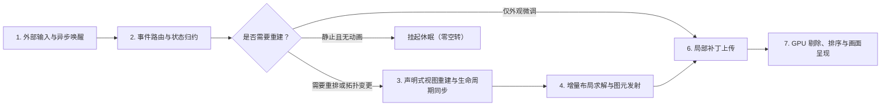

# 帧生命周期

## 1. 核心问题与定位
一帧之内，框架需要协调操作系统事件、应用状态更新、局部组件状态、布局求解、图元生成和 GPU 上传。如果各阶段边界模糊，就容易出现“改了一处颜色却重排整棵树”或“状态与画面差一帧”的问题。本篇定义一帧从输入到呈现的标准执行闭环。

## 2. 核心概念模型
- **外部事件源**：包括原生窗口消息（鼠标、键盘、滚轮、缩放、文件拖放）、定时器到期以及后台异步任务回传的事件。
- **三级脏标记**：用于精确刻画变化的影响范围——仅外观变化（重绘）、尺寸或位置变化（重排）、节点增删（拓扑变更）。
- **场景差分**：通过对比前后两帧生成的图元列表与辅助表，只将真正发生变化的区段上传至显存。

## 3. 单帧执行流程

1. **输入采集与同步**：在帧开始前，将窗口外部状态（如最大化状态、DPI 缩放、当前时间）同步到只读的帧上下文中。
2. **事件归约**：将输入路由到目标节点并执行状态归约，同时处理标准组件的内部交互状态（如按下、聚焦）。
3. **视图重建与挂载差集**：若状态发生变更，重新执行视图构建并计算本帧新挂载与已卸载的组件键，触发对应生命周期通知。
4. **增量排版与图元发射**：仅对受影响的边界子树重新计算布局，随后由各组件发射带有裁剪和层级信息的扁平图元。
5. **场景差分与呈现**：提取变更区段并批量提交给渲染管线，最终由 GPU 完成剔除、排序与绘制。

## 4. 关键设计取舍
- **静止态完全挂起**：当没有外部输入、没有活跃的物理弹簧动画、也没有后台资产就绪时，运行时主动进入休眠，不再空转刷帧，将空闲 CPU 与 GPU 占用压到最低。
- **帧间差分上传取代全量重建**：悬停高亮、光标闪烁等高频微交互只修改局部图元属性或辅助变换表，避免每帧把整棵场景重新推送到 GPU。

## 5. 边界与不变量
- **外部状态前置同步**：窗口宿主同步的状态必须在帧构建开始前写入上下文，禁止在视图构建完成后回写，否则会导致标题栏按钮等 UI 滞后一帧。
- **裁剪栈严格配对**：视图发射期间压入的裁剪区域必须在离开作用域时成对弹出，防止裁剪范围泄漏污染后续图元。
