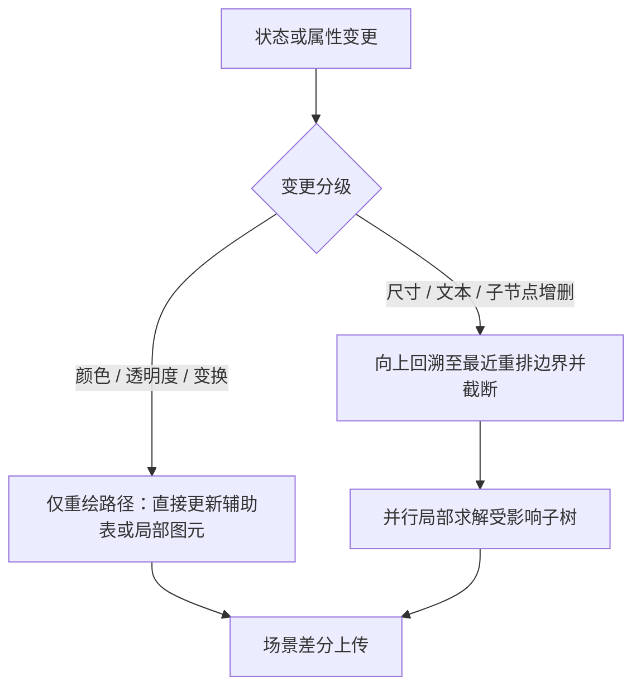

# 性能模型

## 1. 核心问题与定位
在十万级图元、复杂矢量曲线与高刷新率桌面交互下，单纯依靠“事后优化”无法保证流畅度。Unbound UI 将性能预算作为一等架构约束，从数据流源头上剪除不必要的计算与数据传输。

## 2. 核心概念模型
- **静止零开销**：画面无变化时不消耗任何算力，仅在事件唤醒或动画未收敛时推进帧循环。
- **局部隔离边界**：无论是布局变化还是数据更新，都通过显式边界将影响范围限制在最小局部，阻断向全局扩散。
- **GPU 驱动管线**：将可见性剔除、深度排序与阴影计算尽量下沉到 GPU 并行执行，解放主线程 CPU。

## 3. 性能分流与预算策略

## 4. 关键设计取舍
- **扁平连续内存优于对象指针树**：牺牲了部分动态挂载的灵活度，但让视口剔除、空间拾取与场景差分全部变成线性内存扫描，微秒级即可完成单帧校验。
- **高频连续事件禁用树形冒泡**：鼠标移动和拖拽过程只做单目标直达或独占捕获，把复杂的祖先链传递留给低频离散事件（点击、滚轮、按键），从而守住微秒级的拾取耗时预算。
- **离线/异步预处理重计算**：字体字形图集光栅化、多通道有向距离场（MTSDF）生成与图像解码全部放在后台线程池或构建期完成，主渲染线程只做轻量绑定与批处理。

## 5. 边界与不变量
- **拾取耗时红线**：单次常规空间拾取必须保持在微秒级预算内，禁止在拾取热路径中执行动态树遍历或堆内存分配。
- **局部修改禁止全局重排**：容器内部文本或尺寸变化遇到重排边界后必须立即截断，严禁冒泡触发全窗口重排。
- **渲染批次上限**：所有常规 UI 图元通过统一着色器与间接绘制合并提交，不随组件数量线性增加绘制调用次数。
