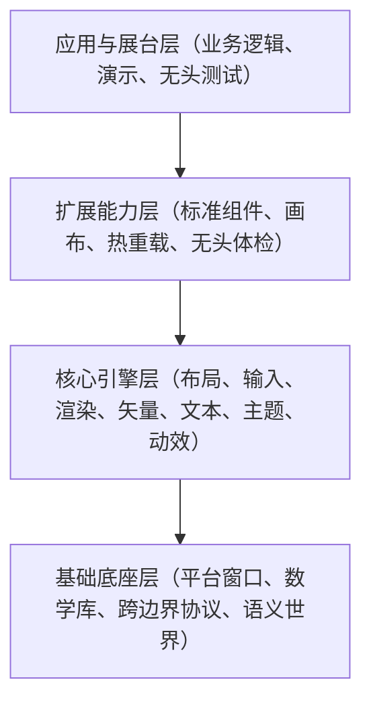

# 设计原则

## 1. 核心问题与定位
传统桌面 UI 框架往往在“开发灵活性”与“底层可控性”之间摇摆：要么引入复杂的面向对象继承和闭包回调导致难以序列化与热重载，要么直接暴露底层图形细节让业务代码变得难以维护。本层确立整个框架的**职责边界、依赖方向与设计哲学**。

## 2. 核心概念模型
- **数据驱动与单向数据流**：界面是应用状态在当前帧的纯函数投影；用户交互产生可序列化的“动作事件”，经统一归约后更新状态并触发下一帧局部重建。
- **动作即数据（Action as Data）**：组件交互不依赖跨边界传递的匿名闭包，而是以可序列化的结构化事件描述意图，天然支持回放、跨线程投递与热重载。
- **面向数据的内存布局**：核心节点与渲染图元采用扁平、紧凑的连续内存组织，避免深层指针跳转与每帧堆内存分配。

## 3. 分层依赖架构

依赖严格单向向下：**下层绝不反向感知上层业务**。例如，渲染层只认识扁平的图元与裁剪指令，不知道“按钮”或“弹窗”的存在；布局层只计算几何矩形，不关心渲染材质。

## 4. 关键设计取舍
- **用扁平协议替代动态对象树**：在核心层之间传递扁平的数据描述符与紧凑数组，牺牲了传统面向对象的多态便利性，换来了零拷贝传输、稳定的二进制边界以及极高的缓存命中率。
- **视图构建与状态变更分离**：视图构建阶段严格保持只读与纯函数特性，禁止在构建界面时直接修改业务状态或发起异步 I/O，确保任意时刻的帧状态都是可复现的。

## 5. 边界与不变量
- **单向依赖红线**：底层图形与数学基础设施严禁反向依赖控件库或应用运行时。
- **热路径零分配**：在常规帧更新、拾取与渲染提交阶段，核心管线不得产生无界的临时堆内存分配。
- **单一数据源**：主题颜色、标准组件目录与全局缩放均由中心化注册表统一定义，禁止各模块私自硬编码旁路样式。
