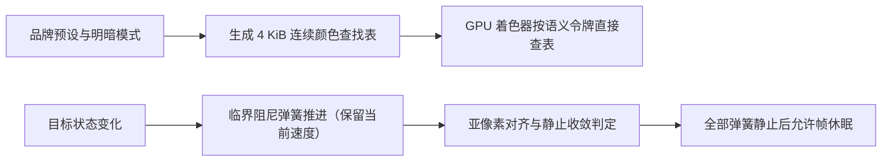

# 主题与动效

## 1. 核心问题与定位
如果主题切换需要逐个通知上万个组件重新计算颜色、或者动画依赖固定的关键帧时长，在高频交互下不仅性能开销大，被打断时的手感也会显得生硬。本模块提供“零遍历主题切换”与“可中断的物理动效模型”。

## 2. 核心概念模型
- **语义颜色查找表（Color LUT）**：组件只持有语义令牌索引（如“主表面”“强调色”“危险边框”），具体颜色值集中存放在一块极小的连续颜色查找表中。
- **三层缩放协调**：统一协调操作系统 DPI 缩放、应用全局逻辑缩放档位以及局部画布缩放，并在物理像素边界执行亚像素吸附，消除 1 像素线条发虚。
- **临界阻尼物理弹簧**：所有过渡动效基于质量-弹簧-阻尼物理方程驱动，以当前速度作为初始条件，天生支持中途无缝打断与反向折返。

## 3. 主题与动效运作机制

## 4. 关键设计取舍
- **GPU 查表替代树遍历换肤**：传统架构切换明暗主题往往需要重建整棵 UI 树；通过将颜色令牌下沉到渲染查表，切换主题只需替换极小的查找表缓冲区，无需重排布局即可瞬间完成全屏换肤。
- **物理弹簧替代固定时长缓动**：固定曲线在快速连续点击（如反复开关侧边栏或拖拽释放）时容易出现位置跳变；弹簧模型保留惯性速度，手感连贯且无需手动维护取消回调。

## 5. 边界与不变量
- **动画收敛即休眠**：当弹簧位移与速度进入收敛阈值后，必须自动标记为静止并对齐到目标终点，确保系统能按预期进入休眠。
- **像素对齐规则**：在低倍率屏幕上，细边框与分割线必须经过像素网格吸附，避免出现半像素模糊。
