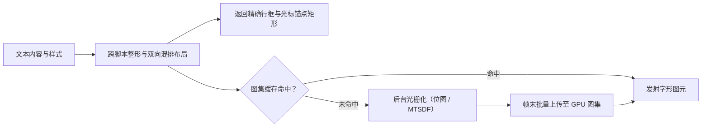

# 矢量与文本

## 1. 核心问题与定位
桌面级设计工具与复杂工作台既需要缩放不失真的曲线与图标，又需要支持中文、拉丁文、双向混排（BiDi）与输入法（IME）的高清晰度文本。本模块负责矢量几何的加速求交与多语言文本的整形、光栅化与输入法协同。

## 2. 核心概念模型
- **曲线包围盒降阶**：对三次贝塞尔曲线先计算紧凑的定向包围盒（OBB）做粗筛，再进行解析求交或有向距离场（SDF）计算，避免昂贵的逐像素通用曲线求值。
- **双图集字形缓存**：常规小字号 UI 文本使用亚像素对齐的灰度/彩色位图图集保证锐利度；大字号标题、可缩放矢量图标与画布文字使用多通道有向距离场（MTSDF）图集，实现任意倍率的平滑缩放。
- **编译期拼音与双拼索引**：内置覆盖常用汉字与多音字的静态拼音表，支持全拼、六种主流双拼方案及首字母匹配，用于框架内高速检索与高亮。

## 3. 文本与矢量处理流

## 4. 关键设计取舍
- **位图与 MTSDF 并存的双图集策略**：纯用距离场会导致极小字号出现轻微边缘发虚，纯用位图在缩放动画或画布缩放时会反复重栅格化并撑爆图集；双图集按使用场景自动分流，兼顾了静帧阅读清晰度与缩放流畅度。
- **离线静态拼音表替代运行时词库**：把汉字到拼音/双拼的映射表在编译期固化为紧凑静态数据，运行时零加载延迟且不依赖外部系统词库。

## 5. 边界与不变量
- **输入法候选框锚定**：文本组件必须能实时算出当前预编辑光标的屏幕矩形区域，确保系统输入法候选窗口准确跟随，不遮挡正在输入的文字。
- **字形图集整帧批量上传**：图集纹理更新必须在渲染提交前一次性批量完成，禁止在绘制过程中穿插纹理拷贝。
