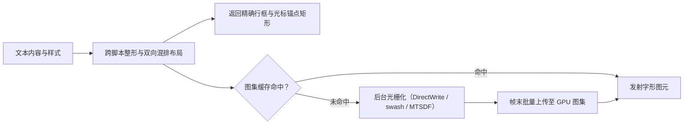

# 矢量与文本

## 1. 核心问题与定位
桌面级设计工具与复杂工作台既需要缩放不失真的曲线与图标，又需要支持中文、拉丁文、双向混排（BiDi）与输入法（IME）的高清晰度文本。本模块负责矢量几何的加速求交与多语言文本的整形、光栅化与输入法协同。

## 2. 核心概念模型
- **曲线包围盒降阶**：对三次贝塞尔曲线先计算紧凑的定向包围盒（OBB）做粗筛，再进行解析求交或有向距离场（SDF）计算，避免昂贵的逐像素通用曲线求值。
- **双图集字形缓存**：常规小字号 UI 文本使用亚像素对齐的灰度/彩色位图图集保证锐利度；大字号标题、可缩放矢量图标与画布文字使用多通道有向距离场（MTSDF）图集，实现任意倍率的平滑缩放。
- **可切换的字形光栅化后端**：塑形、折行与命中测试统一由 `cosmic-text` 负责；覆盖率位图默认由 Windows DirectWrite 生成，采用横竖双向的对称抗锯齿并**关闭网格拟合**——本框架按 ⅛ px 相位自行做亚像素定位，网格拟合会把每个相位重新量化到整像素，小字号下反而产生硬阶梯。DirectWrite 不可用、彩色字形或距离场场景自动回退到 `swash`，环境变量 `UNBOUND_TEXT_BACKEND=cosmic|directwrite` 用于 A/B 对照。
- **编译期拼音与双拼索引**：内置覆盖常用汉字与多音字的静态拼音表，支持全拼、六种主流双拼方案及首字母匹配，用于框架内高速检索与高亮。

## 3. 文本与矢量处理流

## 4. 关键设计取舍
- **位图与 MTSDF 并存的双图集策略**：纯用距离场会导致极小字号出现轻微边缘发虚，纯用位图在缩放动画或画布缩放时会反复重栅格化并撑爆图集；双图集按使用场景自动分流，兼顾了静帧阅读清晰度与缩放流畅度。
- **只替换光栅化，不替换排版**：DirectWrite 只负责单字形覆盖率位图，塑形、换行、BiDi 与光标锚点仍由 `cosmic-text` 提供。这样避免引入第二套排版语义，同时把与 WinUI 差异最大的抗锯齿对齐；代价是放弃 GDI 式网格拟合的整像素笔画、行高仍需按官方度量校准。
- **统一灰度抗锯齿，不接入子像素抗锯齿**：文字覆盖率只按单通道生成与合成。子像素抗锯齿要求一个纹素对应一个物理子像素、目标不透明且图层不变换，并且需要逐通道 alpha；透明中间层只有一个 alpha，无法承载三个独立覆盖率，强行接入会在合成阶段丢信息并产生彩边。代价是放弃低分辨率屏幕上的最后一档水平锐度，换来跨机器、跨缩放的确定性。论证与生态调研见研究文档《ClearType 与亚像素抗锯齿调研》，决策见 ADR 0013。
- **离线静态拼音表替代运行时词库**：把汉字到拼音/双拼的映射表在编译期固化为紧凑静态数据，运行时零加载延迟且不依赖外部系统词库。

## 5. 边界与不变量
- **输入法候选框锚定**：文本组件必须能实时算出当前预编辑光标的屏幕矩形区域，确保系统输入法候选窗口准确跟随，不遮挡正在输入的文字。
- **字形图集整帧批量上传**：图集纹理更新必须在渲染提交前一次性批量完成，禁止在绘制过程中穿插纹理拷贝。
- **后端降级必须可见**：DirectWrite 初始化失败或字体家族缺失时只能回退到 `swash`，不得产生空白字形；默认后端是否为 DirectWrite 由单元测试锁定。
- **抗锯齿不得退化**：DirectWrite 覆盖率必须保留 8 位灰度过渡（中间灰占比有下限），请求的纹理类型必须与抗锯齿模式自洽，禁止出现双电平输出。
- **透明与变换场景不得依赖子像素抗锯齿**：进入图层、带透明度或被缩放/旋转的文本必须使用单通道覆盖率；若未来引入子像素抗锯齿，只能是直接绘制到不透明目标的独立合成路径，不得混入通用图元批次，也不得作为运行时开关暴露。
- **距离场与子像素抗锯齿互斥**：距离场输出标量覆盖率，无法承载三路子像素覆盖率；同一字形不得同时走两条路径。
