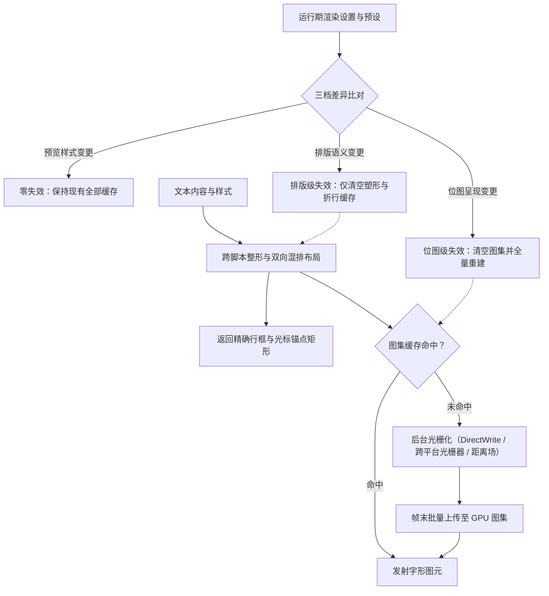

# 矢量与文本

## 1. 核心问题与定位
桌面级设计工具与复杂工作台既需要缩放不失真的曲线与图标，又需要支持中文、拉丁文、双向混排（BiDi）与输入法（IME）的高清晰度文本。本模块负责矢量几何的加速求交与多语言文本的整形、光栅化与输入法协同。

## 2. 核心概念模型
- **曲线包围盒降阶**：对三次贝塞尔曲线先计算紧凑的定向包围盒（OBB）做粗筛，再进行解析求交或有向距离场（SDF）计算，避免昂贵的逐像素通用曲线求值。
- **双图集字形缓存与 RGBA8 按需懒初始化**：常规小字号 UI 文本使用亚像素对齐的灰度覆盖率图集（R8，单页 4 MiB）保证锐利度；彩色 Emoji 与有向距离场（SDF/MTSDF）使用四通道彩色图集（RGBA8，单页 16 MiB）。为杜绝纯文本场景下的显存虚耗，RGBA8 图集采用按需懒加载机制：默认仅初始化 R8 页面，仅当遭遇彩色 Emoji 或分配距离场槽位时才动态开辟 RGBA 页面，纯灰度普通文本渲染显存严格锁定为 4 MiB。
- **可切换的字形光栅化后端**：塑形、折行与命中测试统一由跨平台排版引擎负责；覆盖率位图默认由 Windows DirectWrite 生成，采用横竖双向的对称抗锯齿并**关闭网格拟合**——本框架按 ⅛ px 相位自行做亚像素定位，网格拟合会把每个相位重新量化到整像素，小字号下反而产生硬阶梯。彩色字形同样归 DirectWrite：由层遍历合成，不经过跨平台光栅器。DirectWrite 不可用或距离场场景回退到跨平台光栅器，支持运行期无缝热切换与 A/B 对照。
- **运行期三档失效机制**：文本渲染管线支持在运行期动态切换光栅器、亚像素相位密度（8/4/1 档位）、距离场模式与合成混合空间。为避免策略变更引发全量卡顿，管线采用分级失效：
  - 预览样式变更（仅调整单卡片预览文字样式）不触发任何内部失效；
  - 排版语义变更（字距、行高、断行模式与双向文本开关）仅清空排版塑形与行缓存，保留已光栅化字形位图；
  - 位图与物理呈现变更（光栅化引擎切换、相位档位、距离场模式或彩色图集模式）触发整图集清空与全量位图重建。
- **表驱动能力自省与降级**：引擎在运行期探测平台图形与文本后端能力（包括 DirectWrite 支持度、硬件扩展与距离场着色能力），策略变更与四大预设（原生风格、跨平台一致、像素风、自定义）按能力阶梯安全降级，并向外壳发布只读生效报告。
- **构建档位裁剪与正交 Feature 矩阵**：文本引擎将重型依赖解耦为独立正交的 Cargo Feature（`backend-directwrite` 最小 Win32 依赖绑定，`backend-swash` 纯软光栅与非 Windows 平台支持，`backend-native` 与 `full`）。彩色 Emoji 不再挂在 `backend-swash` 上：只编 `backend-directwrite` 时彩色同样可用，因此「彩色字形可用」这条能力查询取的是「任一彩色路径可用」的并集。底层设有零后端编译期防御断言（`compile_error!`），同时上层提供三态能力查询（`TextCapabilities`）以在单后端构建下将未编译项识别为 `NotCompiled` 并安全降级回退。
- **编译期拼音与双拼索引**：内置覆盖常用汉字与多音字的静态拼音表，支持全拼、六种主流双拼方案及首字母匹配，用于框架内高速检索与高亮。

## 3. 文本与矢量处理流

## 4. 关键设计取舍
- **位图与 MTSDF 并存的双图集策略**：纯用距离场会导致极小字号出现轻微边缘发虚，纯用位图在缩放动画或画布缩放时会反复重栅格化并撑爆图集；双图集按使用场景自动分流，兼顾了静帧阅读清晰度与缩放流畅度。
- **只替换光栅化，不替换排版**：DirectWrite 只负责单字形覆盖率位图，塑形、换行、BiDi 与光标锚点仍由 `cosmic-text` 提供。这样避免引入第二套排版语义，同时把与 WinUI 差异最大的抗锯齿对齐；代价是放弃 GDI 式网格拟合的整像素笔画、行高仍需按官方度量校准。
- **统一灰度抗锯齿，不接入子像素抗锯齿**：文字覆盖率只按单通道生成与合成。子像素抗锯齿要求一个纹素对应一个物理子像素、目标不透明且图层不变换，并且需要逐通道 alpha；透明中间层只有一个 alpha，无法承载三个独立覆盖率，强行接入会在合成阶段丢信息并产生彩边。代价是放弃低分辨率屏幕上的最后一档水平锐度，换来跨机器、跨缩放的确定性。论证与生态调研见研究文档《ClearType 与亚像素抗锯齿》，决策见 ADR 0013。
- **彩色字形按簇层合成，相位锁 0**：一簇彩色字形由 `TranslateColorGlyphRun` 摊平成实色层后合成为一张 RGBA 位图，一簇产出一个四边形与一个图集条目。合成单元必须是簇而不是单字形——一层几何可以横跨多个字形，按单字形切分会裁掉跨界层。彩色簇不参与 ⅛ px 相位缓存：按实测层数（单字形可达 16 层），八相位会把 analysis 次数与显存同时乘 8，而彩色字形是大色块，取整原点的 0.5 px 误差不可辨。图集保持直通 alpha，`uber.frag` 的彩色分支不必改动。论证与实测见 ADR 0017。
- **重型依赖解耦与单后端独立构建**：覆盖 Workspace 顶层的泛化依赖，仅引入最小 DirectWrite COM 接口，纯 DirectWrite 构建彻底剔除 `swash` 与 `zeno`（精简 ~1.8 MiB 体积），纯 Swash 构建剔除全部 Win32 依赖，实现精简分发与极速跨平台编译。
- **离线静态拼音表替代运行时词库**：把汉字到拼音/双拼的映射表在编译期固化为紧凑静态数据，运行时零加载延迟且不依赖外部系统词库。

## 5. 边界与不变量
- **输入法候选框锚定**：文本组件必须能实时算出当前预编辑光标的屏幕矩形区域，确保系统输入法候选窗口准确跟随，不遮挡正在输入的文字。
- **构建档位与零后端防呆**：必须至少激活一个光栅化后端（DirectWrite 或 Swash），禁止空光栅化构建；调用方请求未编译后端时管线必须在运行时安全回退至已编译后端并记录诊断信息，严禁触发 panic。
- **显存峰值受控**：3500 常用汉字在 8 / 4 / 1 相位下的 R8 图集显存严格满足 12 MiB / 8 MiB / 4 MiB 阶梯关系；普通文本绝不触发 RGBA8 图集开辟。
- **字形图集整帧批量上传**：图集纹理更新必须在渲染提交前一次性批量完成，禁止在绘制过程中穿插纹理拷贝。
- **RGBA8 图集按需开辟**：纯普通文本渲染绝不提前预分配 RGBA8 图集页面；单色模式 Emoji 映射至 R8 图集染色，不触发 RGBA8 开辟。
- **三档失效按需触发**：排版参数调整严禁清空字形图集，位图参数调整必须整表清空，杜绝跨模式字形缓存污染；预览样式变更不得影响全局管线。
- **预设安全降级**：预设应用严禁导致无效状态，遇机器能力缺失必须回退至跨平台兼容档位并向外壳报告真实生效状态。
- **后端降级必须可见**：DirectWrite 初始化失败或字体家族缺失时只能回退到跨平台光栅器，不得产生空白字形；彩色簇合成失败时按簇回退并计入运行期报告，不得静默产出空白四边形。生效报告还须标出**已知差异**（`known_deviation`）：例如跨平台光栅器的 `Mono` 仍取彩色位图亮度，与 DirectWrite 的基字形剪影不是同一张图；面板不能把两个后端的同名设置显示成等价。默认后端是否为 DirectWrite 由单元测试锁定。
- **抗锯齿不得退化**：DirectWrite 覆盖率必须保留 8 位灰度过渡（中间灰占比有下限），请求的纹理类型必须与抗锯齿模式自洽，禁止出现双电平输出。
- **透明与变换场景不得依赖子像素抗锯齿**：进入图层、带透明度或被缩放/旋转的文本必须使用单通道覆盖率；若未来引入子像素抗锯齿，只能是直接绘制到不透明目标的独立合成路径，不得混入通用图元批次，也不得作为运行时开关暴露。
- **距离场与子像素抗锯齿互斥**：距离场输出标量覆盖率，无法承载三路子像素覆盖率；同一字形不得同时走两条路径。
