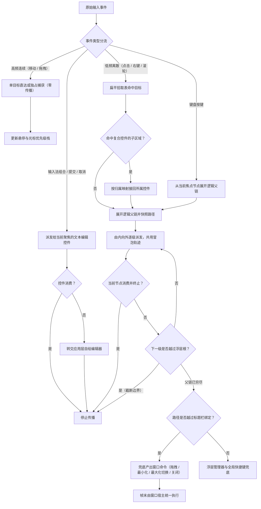

# 输入与事件冒泡

## 1. 核心问题与定位
桌面 UI 同时存在“按钮内嵌套文字”、“可点击卡片内嵌套独立小按钮”、“弹窗浮层盖在背景页上”以及“输入框内按 Esc 退出编辑 vs 关掉整个弹窗”等复杂交互。若照搬 Web 的三阶段传播模型，高频指针拾取会被逐层派发拖慢；若完全不传播，嵌套组件又无法协同，父级只能靠额外发射命中区域或全局状态猜测目标。本模块以**空间拾取与逻辑传播分离**的分层混合模型，兼顾微秒级响应与复合交互的正确性。

## 2. 核心概念模型
- **拾取表与语义树分离**：底层维护一张按层级与绘制深度排序的扁平命中区域表，只回答“光标正下方是谁”；离散事件的传播则沿语义树的逻辑父链由内向外进行。
- **显式浮层根**：浮层边界由节点上的语义标记或浮层管理器栈声明，与绘制深度彻底解耦；绘制深度只影响前后遮挡与拾取层抬升，不再隐含边界语义。
- **子区域归属**：复合控件内部的小部件（分页项、表格行、滚动条滑块等）无需进入语义树，由场景构建阶段登记“命中键 → 所属控件”，运行时据此接回逻辑父链。
- **冒泡轨迹**：一次派发的访问路径与终止点被统一采集，供调试检查器及按下—释放一致性校验复用。
- **冒泡终点产出窗口命令**：标题栏背景带以一个最低优先级命中区参与冒泡，只作起点、从不拦截；若整条逻辑父链无人终止，则标题栏绑定把这次事件收束为拖拽、最小化、最大化切换或关闭命令，交由窗口宿主在帧末执行。
- **独占指针捕获**：按下或开始拖拽后指针锁定到当前目标，移出控件甚至窗口时后续移动与释放仍独占路由给它。
- **聚焦编辑控件先于应用消费输入法**：组合、提交与取消优先派发给当前聚焦的文本编辑控件；控件消费后事件不再转交应用层，只有无人消费时才回落到应用自绘编辑器。
- **点击穿透与确定性光标栈**：纯展示型子节点不接收输入事件，拾取时直接跳过；光标外观按优先级栈（捕获态 > 悬停区域 > 缩放手柄 > 默认箭头）解析，消除移入移出时的闪烁竞态。

## 3. 工作流程与流向图

## 4. 关键设计取舍
- **逻辑父链优于空间重叠栈**：按画面前后重叠关系传播，会把视觉重叠的兄弟节点误当成父子，弹窗未消费的点击也会漏到背景页。逻辑父链配合浮层边界截断杜绝误穿透；代价是命中区域必须能解析回语义树节点。
- **显式边界优于隐式深度**：早期用绘制深度阈值推断浮层，导致任何为遮挡兄弟而抬高深度的普通容器都会提前截断传播。现在浮层根由语义标记或浮层管理器声明，绘制深度回归纯视觉职责。
- **离散统一传播、连续零传播**：点击、右键、滚轮与键盘共用一套“继续 / 停止”语义与轨迹采集，避免多处派发循环各自漂移；移动与拖拽仍走单目标或独占捕获，守住高频路径的延迟预算。
- **归属映射代替额外命中区域**：子部件登记归属后自动接入父链，控件不必为“让父级收到事件”再发射一层命中区域；代价是场景构建阶段需维护一帧有效的归属表。
- **裸区域按空间栈回退**：未挂进语义树的命中区域（如画布四叉树或外部注入区域）在父链展开后补入路径；声明式节点不回退，否则浮层截断后背景控件会重新渗透。
- **兜底命令优于平台二次判定**：窗口拖拽与关闭若交回窗口层按坐标判断，业务就失去拦截关闭的机会，且平台与引擎两份命中判断会在缩放边界处互相矛盾。现在统一由冒泡兜底排队成命令；代价是路径必须携带“是否越过标题栏”的信息，且拖拽启动延后到本帧末尾。
- **不引入完整捕获阶段**：父级先于子级拦截的极少数场景由浮层管理器统一处理，换取更低的组件心智负担。

## 5. 边界与不变量
- **模态隔离红线**：模态浮层打开期间，离散点击与滚轮事件在浮层根边界即刻截断，严禁渗透到背景页面；键盘焦点同样限制在模态作用域内，且边界必须显式声明，绘制深度不得替代。
- **控件不得硬编码层级**：控件只声明自身绘制深度与光标，拾取层与浮层内的深度抬升由运行时统一注入。
- **放弃按下不可激活**：按下时快照传播路径，窗口失焦或取消捕获必须清理按下状态与快照，后续释放绝不能合成有效点击。
- **拦截即静默**：任一祖先返回终止后，窗口命令绝不再产出；要拦住关闭，只需在关闭按钮到标题栏根之间的任意一级终止事件，无需额外开关。
- **输入法消费即终止**：聚焦控件消费组合或提交事件后，应用层绝不能再收到同一事件，否则同一次提交会被插入两次。
- **命令必须目标自证**：窗口控制命中的是释放时的目标而非起点——从背景带按下、滑到关闭按钮再松开，不得产出关闭命令；反过来，在关闭按钮按下、滑出后松开也不得关闭。
- **可观测性**：开启调试检查器时，指针、键盘与滚轮事件统一记录完整冒泡路径及在哪个节点被终止；新增离散派发点必须复用同一套轨迹采集。
