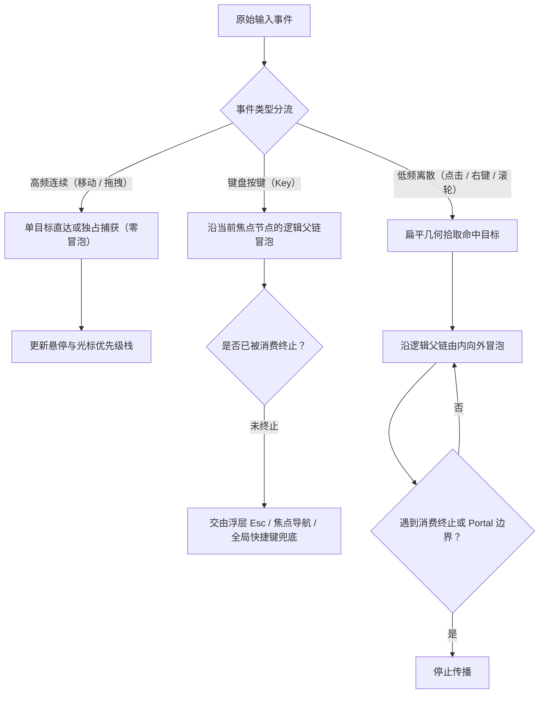

# 输入与事件冒泡

## 1. 核心问题与定位
桌面 UI 同时存在“按钮内嵌套文字”、“可点击卡片内嵌套独立小按钮”、“弹窗浮层盖在背景页上”以及“输入框内按 Esc 退出编辑 vs 关掉整个弹窗”等复杂交互。如果全部照搬 Web DOM 的三阶段全事件冒泡，会拖慢高频指针拾取；如果完全不冒泡，嵌套组件又无法协同。本模块通过**分层混合模型**同时兼顾微秒级性能与复合交互可用性。

## 2. 核心概念模型
- **几何拾取层与逻辑传播层分离**：底层维护一张按层级与深度排序的扁平拾取区域表，只负责回答“光标正下方是谁”；事件冒泡则沿着语义树的逻辑父链向上传递。
- **点击穿透**：纯展示型子节点（如按钮里的文字标签或装饰图标）标记为不接收输入事件，拾取时直接跳过，零开销命中外层容器。
- **独占指针捕获**：按下或开始拖拽后，指针被锁定到当前目标；即使光标移出控件甚至移出窗口，后续移动与释放事件仍独占路由给它。
- **确定性光标栈**：光标外观按优先级栈（捕获态 > 悬停区域 > 缩放手柄 > 默认箭头）解析，消除子控件移入移出时的光标闪烁竞态。

## 3. 统一事件路由与冒泡流程

## 4. 关键设计取舍
- **一套冒泡机制统一所有离散事件**：点击、右键菜单、滚轮与键盘统一沿着逻辑父链向上传播，共享同一套“继续冒泡 / 停止传播”语义；仅对非声明式裸区域保留空间栈回退。
- **用逻辑父链代替空间重叠栈**：如果仅按画面上的前后重叠关系冒泡，视觉重叠的兄弟节点会被误当成父子，弹窗未消费的点击也会漏到背景页。沿着逻辑父链并在浮层边界处强制截断，彻底杜绝了误穿透。
- **不引入完整的捕获（隧道）阶段**：不在所有节点上暴露前置捕获回调，极少数需要“父级先于子级拦截”的场景（如点击模态框外部关闭）由浮层管理器统一处理，大幅降低组件心智负担。
- **内置控件消费默认截断**：标准交互控件（如按钮、滑块、输入框）内部真正消费了按下或按键事件后，默认终止继续冒泡，防止用户点按钮时误触外层卡片。

## 5. 边界与不变量
- **模态隔离红线**：模态弹窗打开期间，离散点击与滚轮事件在浮层根边界即刻截断，严禁渗透到背景页面；键盘焦点也被限制在模态作用域内。
- **放弃按下不可激活**：若按下中途窗口失焦或取消捕获，必须清理按下状态，后续释放事件绝不能合成一次有效点击。
- **可观测性**：开启调试检查器时，可追踪最近一次离散事件的完整冒泡路径及在哪个节点被终止。
