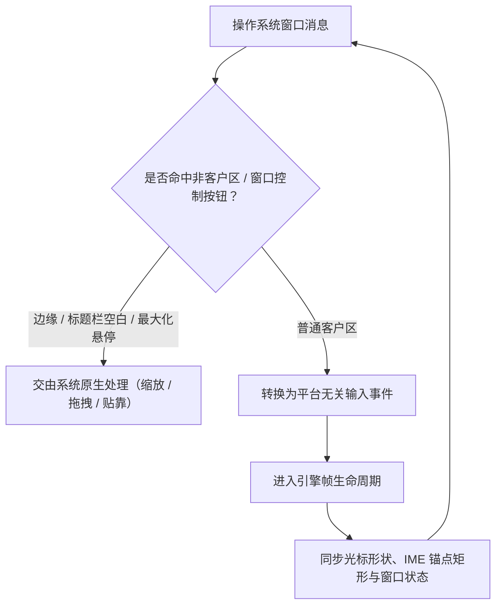

# 平台与窗口集成

## 1. 核心问题与定位
自绘 GPU UI 框架如果脱离了操作系统原生窗口机制，就会失去系统级体验——例如无边框窗口无法边缘缩放、不支持系统的窗口贴靠布局（Snap Layouts）、或者输入法候选框位置错乱。本模块定义引擎与操作系统窗口层之间的桥梁。

## 2. 核心概念模型
- **三段式自定义标题栏**：由应用自行绘制标题栏外观与业务插槽，同时在右上角保留几何窗口控制按钮，空白区域自动映射为系统原生标题栏拖拽与双击最大化。
- **非客户区命中协同**：窗口边缘（四边与四角）及最大化按钮在操作系统命中测试阶段按优先级返回原生系统语义，使系统原生边缘缩放与贴靠菜单无缝生效。
- **多窗口与穿透覆盖层**：支持多窗口生命周期管理，以及根据每帧交互区域动态切换“鼠标捕获”与“透明穿透”的工具浮窗。

## 3. 原生消息与引擎桥接流程

## 4. 关键设计取舍
- **自绘外观 + 原生交互语义**：既不退回丑陋的系统默认标题栏，也不用业务代码去手写脆弱的窗口拖拽与缩放逻辑，而是通过精确的非客户区命中优先级把两者结合起来。
- **呈现同步预算控制**：交换链呈现与垂直同步等待受到严格预算约束，防止最小化、遮挡或窗口调整大小时阻塞主事件循环。

## 5. 边界与不变量
- **边缘缩放优先于覆盖层穿透**：系统非客户区命中测试中，窗口按钮与八方向边缘缩放判定必须优先于覆盖层透明穿透策略，否则窗口将无法缩放或关闭。
- **无障碍语义桥接**：引擎产出的界面语义树必须实时同步到操作系统无障碍接口，保证读屏器与辅助工具可正常工作。
