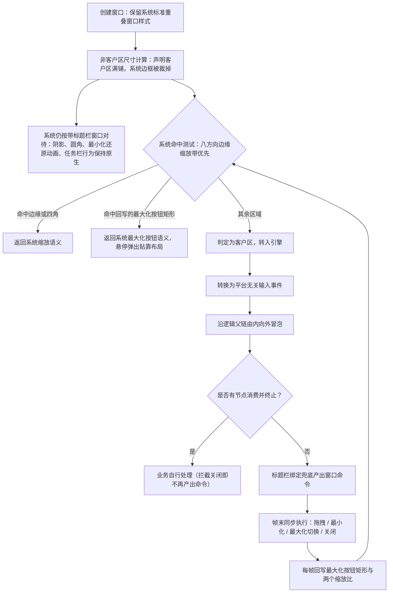
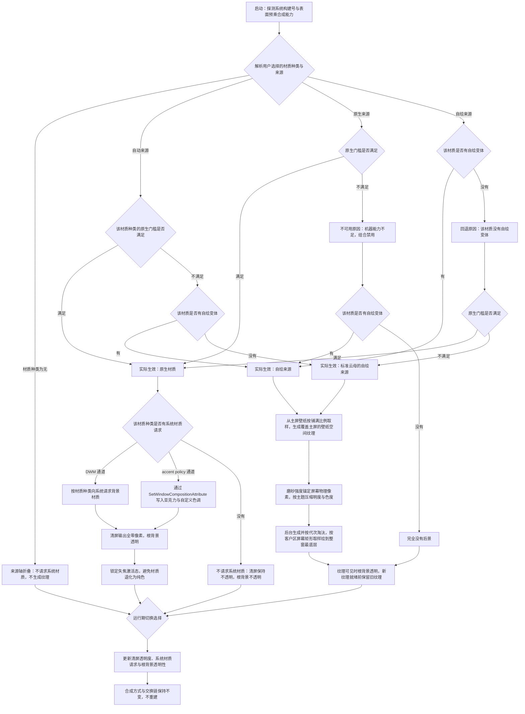
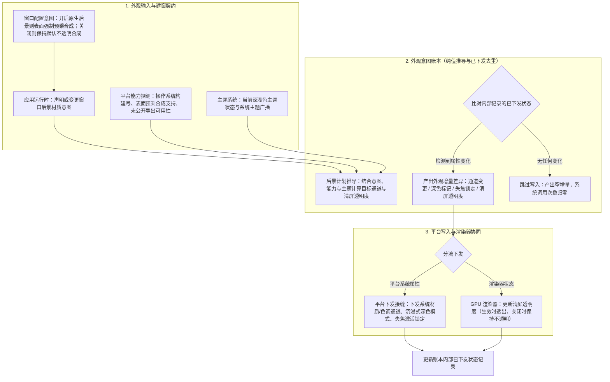
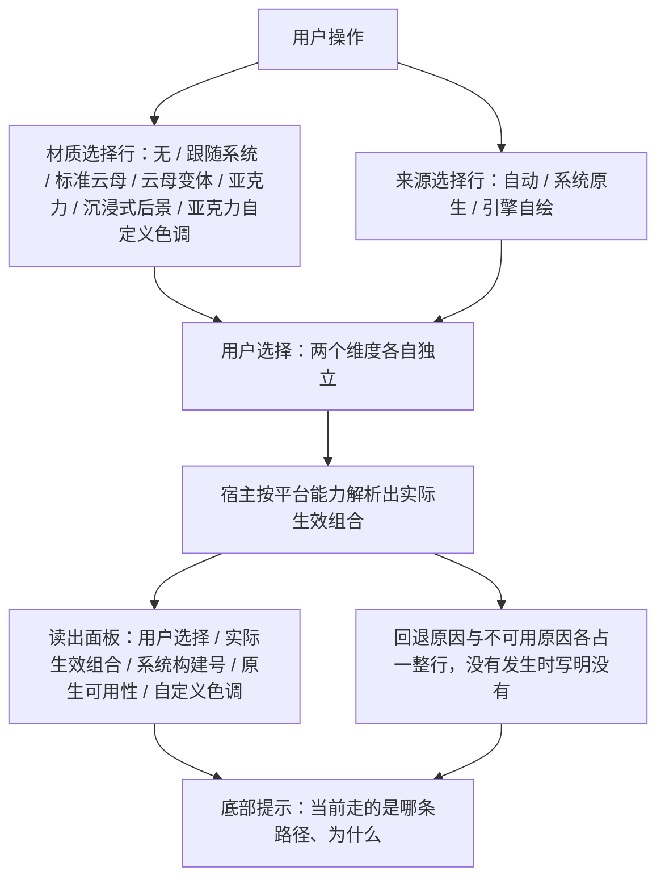
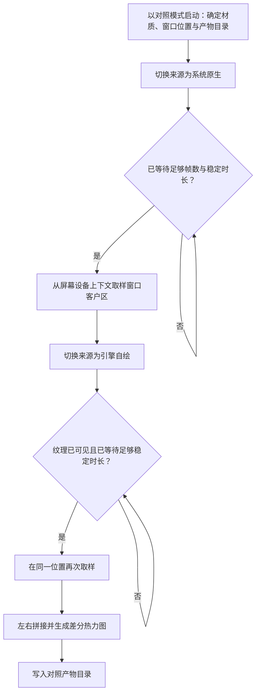

# 平台与窗口集成

## 1. 核心问题与定位
自绘 GPU UI 框架如果脱离操作系统原生窗口机制，就会失去系统级体验——窗口不能边缘缩放、不支持系统贴靠布局、输入法候选框位置错乱；而如果反过来把交互全部交还系统，业务又无法拦截“关闭前先确认未保存”这类需求。本模块定义引擎与操作系统窗口层之间的桥梁，并划清“哪些交互交还系统、哪些交互必须留在引擎”的边界。

## 2. 核心概念模型
- **裁切式无边框窗口**：窗口仍按系统标准重叠窗口创建（保留标题与边框能力位），再由引擎在非客户区尺寸计算阶段声明“客户区满铺”，把系统边框在视觉上整体裁掉。系统依旧认为这是一扇带标题栏的窗口，因此阴影、圆角、最小化与还原动画、任务栏与切换器行为全部保持原生。
- **双尺度坐标**：界面坐标系带“合成缩放”（显示器物理缩放乘以用户可调界面缩放），窗口坐标系带“显示器缩放”。逻辑视口由物理客户区尺寸除以合成缩放得出，字形光栅化与渲染相机统一按合成缩放映射回物理像素，命中矩形则按合成缩放与显示器缩放之比换算后与系统命中区域对齐。
- **窗口几何消息合并与模态即时帧**：窗口拖拽移动或调整尺寸期间，队列中连续到达的窗口位置变更、尺寸变更与指针移动事件各自只保留最新一项；在操作系统模态移动/缩放循环阻塞期间，收到位置或尺寸变更时走同一个即时帧泵直接驱动单帧同步重绘，避免退出拖拽后逐帧回放整条历史几何轨迹，造成松手后的位置突跳或慢动作缩放。
- **命中区域回写**：引擎每帧只把**最大化按钮**的矩形换算后回写窗口层，其余窗口控制按钮一律回写空矩形，使其保持在客户区、由引擎自主派发。
- **输入法事件桥接**：平台层只上报系统输入法的“组合中 / 提交 / 取消 / 启用状态”，不缓存待提交文本；组合串与提交串都进入同一份编辑状态归约，组合期间的光标与选区由该状态自行推导。
- **窗口命令队列**：拖拽、最小化、最大化切换、关闭四类意图以命令形式在帧内排队，由窗口宿主在帧末统一执行；命令的唯一产出方是引擎的冒泡兜底，平台层不再按坐标二次判定。
- **多窗口与穿透覆盖层**：支持多窗口生命周期管理，以及根据每帧交互区域动态切换“鼠标捕获”与“透明穿透”的工具浮窗。
- **材质种类与来源两轴正交的后景模型**：后景由两个彼此独立的维度共同决定——「材质种类」描述看起来是什么（无、跟随系统、标准云母、云母变体、亚克力、沉浸式后景、亚克力自定义色调），「来源」描述由谁把它画出来（自动、系统合成器直接生成，或引擎自绘壁纸纹理）。同一材质可以有两种实际来源，观感应当接近但能力前提与失效条件不同；材质种类为「无」时来源轴折叠，不请求任何系统材质也不生成纹理。系统请求有两条互斥的通道：DWM 的 `DWMWA_SYSTEMBACKDROP_TYPE` 与未公开的 accent policy；亚克力自定义色调走后者，因此它同样“有系统请求”，但请求值不是 DWM 材质取值。宿主按实际生效材质二选一，同一窗口绝不同时下发两条通道。交换链的合成方式在启动时按平台能力一次性固定：能力可用即预乘 alpha，否则不透明；之后不再随选择变化。客户区只有在实际生效来源为系统原生**且**该材质种类确实存在系统材质请求时才输出全零像素，系统材质才能透出；非原生来源用不透明清屏保持视觉不透明，没有系统材质请求的材质档（当前是沉浸式后景，它的系统取值尚未公开收录）即使走原生来源也保持不透明，否则会得到一张透明却没有材质的空窗口。平台硬限制是预乘合成与呈现缩放不能共存，因此具备原生能力的机器整条生命周期放弃呈现缩放请求，接受调整窗口尺寸过渡帧可能被拉伸的代价。自绘来源沿用后台后景子系统：从主屏壁纸按铺满比例取样、降采样磨砂，再按主题压缩明度与色度生成**壁纸空间纹理**；应用层负责后台生成、代次淘汰与纹理资产提交。同一种磨砂锚点可以配不同的色调配方：云母变体在标准云母配方上追加更深的明度压缩，因此材质种类必须进入纹理请求与失效判定——切换材质即按代次重建，新纹理就绪前继续绘制旧纹理。
- **两行选择与读出面板**：展台的后景页把两个维度拆成两行互不重叠的按钮——上行选材质种类（无、跟随系统、标准云母、云母变体、亚克力、沉浸式后景、亚克力自定义色调），下行选来源（自动、系统原生、引擎自绘）；两个维度各自独立，改一行不动另一行。读出面板同时给出五组事实：用户当前的选择、宿主解析出的实际生效组合、系统构建号、所选材质种类的原生可用性、当前亚克力自定义色调（十六进制 ABGR）；回退原因与不可用原因各占一整行，没有发生时显式写明没有。两行按钮各自带角色、可读名称与选中态，可读名称以所属维度打头，读屏器能分清哪一行是什么。面板底部再用一句话说明当前走的是哪条路径、为什么。
- **材质组合的可用性判定与回退**：用户只表达“想要哪种材质、想要哪条来源”，宿主结合平台能力把选择解析为唯一实际组合，并向页面暴露实际组合、清屏透明度、根背景透明性与回退原因。可用性按材质种类逐档声明：多数材质要求系统构建号不低于 22621（通过系统内核版本接口探测，非系统环境或探测失败视为未知）**且**图形表面支持预乘合成；沉浸式后景额外要求构建号不低于 26100，属公开文档未收录的实验档；亚克力自定义色调走自己的门槛（accent policy 亚克力记载为 build 17134 引入）并额外要求运行时能解析出未公开导出 `SetWindowCompositionAttribute`，该能力由平台层单独探测后作为专属字段传入，不复用云母门槛、也不影响其它材质。机器能力不足时该组合禁用并标注原因；组合本身非法（该材质没有自绘变体）时允许选中，由宿主回退并在读出面板说明回退结果与原因。无头与非系统环境同样保持自绘来源。自绘覆盖边界是材质种类上的一次性声明（等价重现或无变体），布尔判断、组合解析与展台按钮状态全部从它派生。
- **解析阶梯与两类原因**：组合解析是纯函数，逐条按来源给出实际生效结果。材质种类为「无」时来源轴折叠，什么都不请求；选自动来源时始终落到可用组合——原生可用走原生，否则改走自绘并说明原生不可用；选原生来源而机器承载不了时属于**能力不足**而不是降级，该组合禁用并给出不可用原因，若该材质有自绘变体则实际生效组合改走自绘，否则完全没有后景；选自绘来源而该材质没有自绘变体时组合非法，允许选中并按“先保材质种类、再保来源”的顺序降级——原生可用时保留材质种类改走原生，否则保留自绘来源改用标准云母。回退原因与不可用原因必须分开呈现：前者说明“变成了什么”，后者说明“为什么这台机器用不了”。覆盖边界只有一处声明：标准云母与云母变体可等价自绘，亚克力、亚克力自定义色调与沉浸式后景则没有自绘变体——亚克力与它的自定义色调子档靠噪点与层叠感辨识，沉浸式后景是系统里并不存在的取值，自造自绘变体只会得到误导性对照。
- **无头纹理统计接缝**：自绘后景的观感可以脱离显示环境独立度量——输入壁纸像素与目标屏幕像素，输出空间梯度能量、明度带宽与色相保真度三项数值。它复用与真实生成完全相同的配方（铺满取样、降采样、屏幕锚定磨砂、主题色调），因此数值反映的是真实产物而不是另算的一套近似；磨砂锚点是否漂移因此能在无显示环境里被断言守住。统计按材质种类选择色调配方：云母变体与标准云母共享同一个磨砂锚点，只有明度带宽与对比度因更深的色调而降下来。
- **窗口外观意图账本**：把应用声明的外观意图（原生云母、亚克力、自定义色调或无后景）、底层操作系统版本构建号与图形表面能力，收敛为唯一的后景执行计划与增量差异。账本保持纯值进、增量出，不持有任何原生窗口句柄或图形资源，通过在内部记录已下发状态执行逐帧比对，消除高频冗余系统写入与潜在画面闪烁。
- **外观增量差异与通道互斥**：一次外观同步所产生的一组平台系统调用与渲染器参数增量。后景通道之间保持互斥闭环：切换至系统标准材质前先清除未公开色调策略，反之切换至自定义色调通道时将标准材质归零；沉浸式深色模式标记作为所有窗口通用的系统外观属性，无论是否开启原生后景均在建窗首帧与主题变更时持续同步；清屏透明度根据后景计划自动派生，在开启后景且表面支持预乘合成时输出透明，在意图关闭或能力不足时安全钳回不透明。
- **外观平台下发接缝**：将外观增量差异中的操作系统平台级写入（系统后景材质通道、未公开色调策略、沉浸式深色模式与失焦激活锁定）收敛为单一的复用入口，由各宿主（无论是通用窗口运行器还是自定义宿主）统一调用，消除逐行重复与平台写入规则漂移。

## 3. 原生消息与引擎桥接流程

### 材质组合的启动解析与运行期切换

组合解析本身是纯函数：输入只有用户选择与平台能力，输出唯一实际组合与两类原因，不做任何系统查询，也不读全局状态。因此“材质种类 × 来源 × 平台能力”的全部组合可以在无显示环境里穷举断言。全仓库只保留两轴模型这一套选择语义：旧的整窗路径枚举、它的翻译层与等价性夹具都已退休，不再存在第二套并行的表达。

自绘纹理与窗口解耦：纹理覆盖整块主屏并按铺满比例生成，窗口只通过客户区屏幕矩形计算 UV 子矩形取自己那一块。窗口移动或缩放只改变 UV，不重新解码壁纸；只有主屏尺寸、DPI 缩放、主题、材质配方或壁纸源发生变化时，旧纹理才失效并进入下一代生成，标准云母与云母变体之间切换也在其列。部分越界时 UV 按主屏边界钳制，完全无交集时退回整张纹理，保证采样区域始终有效。磨砂强度以屏幕物理像素为基准，与壁纸分辨率、屏幕分辨率无关：同一台机器上换壁纸只改变色调与构图，不改变磨砂观感。

### 外观意图账本与运行期外观数据流

外观意图账本将策略推导与系统调用完全解耦：
1. **启动建窗契约**：建窗阶段依据窗口配置中的后景意图裁决表面合成方式。显式意图开启原生材质时，强制将表面合成方式选为预乘合成以支持系统材质从底层透出；若意图关闭，严格保持基础配置的不透明合成，确保不透明窗口改造前后逐字节一致。
2. **纯值推导与去重**：运行期应用运行时只表达意图，外观账本逐帧比对已下发值，仅产出包含实际变更的增量差异。未发生变化的通道与标记在增量中为缺失，不产生任何系统调用。
3. **沉浸式深色模式解耦**：深色模式标记作为所有窗口通用的系统外观属性，不与后景通道绑定。普通窗口在首帧建窗、系统主题广播或主动切换主题时，均由增量差异下发沉浸式深色标记，确保深色模式广播绝不切断。
4. **清屏透明度优先级**：开启后景时清屏透明度由账本根据后景计划独占派生；仅在后景意图关闭时，宿主手动设置的清屏透明度才作为兼容或自绘兜底生效。
5. **统一平台下发接缝**：所有系统属性写入收敛为单一复用入口，无论是通用窗口运行器还是自定义宿主均调用同一份平台下发逻辑，消除逐行重复与平台写入规则漂移。

### 展台页面的两行选择与读出面板

两行按钮的部件编号互不重叠：材质行占前一段，来源行接在其后，宿主按同一套编号派发点击，改一行不动另一行。读出面板只呈现宿主解析出的结论，页面不自行推导可用性；两类原因各占一整行，几十个字的长说明才有地方展开。

材质行按当前来源逐档裁决可用性：来源为原生时要求该档能走原生；来源为自动时要求原生可用，或该档有自绘变体；来源为自绘时永不因缺少自绘变体而禁用（非法组合允许选中并展示降级）。构建号未知一律视为不可用。门槛不过的按钮进入禁用态，并在按钮内与读出面板显示英文原因，点击禁用项不会改变选择。选中的非法组合另有独立视觉标记——按钮顶边一条告警色细条、边框换成告警色、右下角标出“INVALID COMBO”，无障碍名称也追加“组合非法”的说明——这样“我选的组合不合法”与“这台机器跑不了”在界面上是两种不同的样子，而不是同一条回退文案。实验档（沉浸式后景与亚克力自定义色调）在按钮角标上显式标出“实验”，与常规档区分。

### 屏幕捕获对照通道

对照看的是**桌面合成结果**：渲染器回读只能看到本进程提交的交换链内容，看不到合成器把系统材质与壁纸合成之后的样子，因此另立一条从屏幕设备上下文取样的通道，两条通道并存、互不替代。离屏回读继续服务既有的页面视觉回归；屏幕取样只服务原生与自绘后景的人工对照。

坐标必须显式对齐：捕获矩形与窗口客户区屏幕矩形都使用屏幕物理像素，捕获结果自带原点与尺寸；自绘纹理以主屏矩形为画布，屏幕像素映射到纹理 UV 前先减去主屏原点，绝不假设主屏从零开始。部分越界按主屏边界钳制，完全无交集时明确失败而不是伪造像素。整个对照只切换来源、不移动窗口，两次捕获因此覆盖同一块屏幕区域；一旦尺寸不一致就直接报错，不做裁剪或缩放。非 Windows 或拿不到屏幕设备上下文时返回明确的“不支持”结果，不会崩溃。

人工验收流程：以对照模式启动展台，用参数覆盖产物名称、材质、窗口位置与输出目录；同一窗口位置下程序先切原生、等合成器稳定后取样，再切自绘、等纹理可见后取样，最后写出原生截图、自绘截图、并排对比图与差分热力图，全部落在构建输出目录下的对照子目录。该基线刻意不进入持续集成门禁：结果依赖真实窗口、桌面合成器与壁纸内容，像素数值会随机型、DPI、主题与壁纸漂移，把它设为必需步骤只会得到一条依赖桌面的不稳定测试；因此只保留人工验收，不做任何像素数值或阈值断言。

## 4. 关键设计取舍
- **保留系统标题栏能力位再裁切，优于弹出式无边框窗口**：完全无边框的弹出式窗口拿不到系统阴影与圆角，最小化与还原动画退化为硬切，任务栏与切换器行为也会异常。代价是必须准确回应非客户区尺寸计算，任何偏差都会残留一条系统边框或让客户区溢出。
- **只交还最大化按钮，优于交还整条标题栏**：系统贴靠布局只认“命中测试返回最大化按钮语义”这一个钩子，因此回写一个矩形即可，其余按钮留在客户区由引擎派发，业务才有机会拦截关闭。代价是最小化与关闭丧失系统默认的按下反馈，必须由引擎自绘悬停态与按下态。
- **命令化产出优于平台直接夺取**：拖拽与双击最大化不再由窗口层按坐标猜测，而是冒泡全程无人拦截时兜底排队成命令。业务在任意祖先返回终止即可改变行为，也不存在“平台判一次、引擎再判一次”的双份命中在缩放边界处互相矛盾。代价是拖拽启动被推迟到本帧事件处理末尾。
- **双尺度显式换算**：早期直接把界面坐标当作窗口逻辑坐标回写，在 1.25 倍界面缩放的机器上，热区会整体偏移约四个按钮宽度，贴靠菜单在标题栏中部弹出。换算公式下沉为单一公开入口，避免各调用点各自乘一个系数。
- **Win11 原生优先、Win10 自绘回退，优于仅自绘**：Win11 的系统云母由合成器直接采样壁纸，零后台解码、零纹理内存，窗口移动与失焦时材质表现由系统维护；代价是原生能力可用的机器整条窗口生命周期都固定为预乘合成并放弃呈现缩放参数，且必须按操作系统构建号判定可用性。Win10 等不支持原生路径的环境继续用壁纸派生纹理自绘，完全可控、跨窗口一致，也能在拿不到静态壁纸时确定性回退纯色底。
- **材质种类与来源两轴正交，优于拍平成单一枚举**：拆开之后，“系统原生”与“引擎自绘”不再互相排斥，“系统不支持某种材质”与“某种材质没有自绘变体”成为两类可分别处理的不可用原因，界面也能分别给出“禁用并说明”与“允许选中并回退”两种处理。代价是模型里多了一层组合，宿主接受的是组合而非单一选择，界面必须同时呈现两个维度。
- **屏幕取样与渲染器回读分设两条通道，优于让回读兼任验收**：回读只覆盖本进程提交的交换链内容，天然看不到系统材质与壁纸的合成结果；屏幕取样虽然依赖真实桌面，但能给出用户实际看到的画面，两个来源路径的差异才可能被观察到。代价是这条通道只能人工运行，且结果不能作为稳定的像素基线。
- **未公开 accent policy 通道独立成档，优于塞进 DWM 材质枚举**：亚克力自定义色调的色调参数是 ABGR 整数，DWM 材质是固定枚举，两者语义与写入路径都不同。把它表达成“计划里的独立 accent 色调字段 + 宿主二选一”，既保持了宿主系统材质类型与既有 DWM 写入路径完全不变，也让“这条通道是否可用”成为可以单独探测、单独禁用的能力。代价是后景计划与宿主各多一条互斥分支。
- **意图关闭时保持默认不透明合成，优于全生命周期盲目强制预乘**：未开启后景的普通应用窗口不需要承担透明合成的驱动开销与潜在呈现限制，严格保持不透明合成确保改造前后行为逐字节一致；只有显式开启原生后景时才强制预乘。
- **深色模式作为所有窗口通用系统属性，优于仅在后景开启时同步**：Windows 沉浸式深色标题栏是现代桌面应用的基本外观体验，普通窗口同样需要根据主题广播与主动切换同步深色标记；将深色模式与后景通道解耦，避免普通窗口深色广播被切断。
- **外观意图账本纯值设计与下发接缝收敛，优于各宿主自行手写系统调用**：账本本身不持有任何窗口句柄与图形设备，使其可在无窗口、无 GPU 环境下完成全矩阵微秒级单元测试；下发逻辑提炼为统一的平台辅助接缝，杜绝各宿主私有映射与规则分裂。

## 5. 边界与不变量
- **最小化与关闭绝不回写**：只允许最大化按钮的矩形进入系统命中测试。一旦回写关闭按钮，系统会把点击转成非客户区按钮抬起并直接关窗，应用层永久失去拦截能力。
- **标题栏高度必须归零**：引擎不得再向窗口层声明“标题栏高度”，否则系统会在该条带直接夺取拖拽，与冒泡兜底重复触发，表现为拖拽抖动或双击最大化连点。
- **命中矩形必须按双尺度换算**：任何新增回写矩形都走同一换算入口，且矩形为零时等价于“不交还”，禁止用近似屏幕坐标硬编码。
- **边缘缩放优先于覆盖层穿透**：系统非客户区命中测试中，窗口按钮与八方向边缘缩放判定必须优先于覆盖层透明穿透策略，否则窗口将无法缩放或关闭。
- **无障碍语义桥接**：引擎产出的界面语义树必须实时同步到操作系统无障碍接口，保证读屏器与辅助工具可正常工作。
- **建窗启动合成方式依意图裁决且生命周期内固定**：启动建窗时，只有当配置中显式开启原生后景材质时，表面合成方式才强制选为预乘合成；若意图关闭（未配置或配置为无），严格保持默认的不透明合成，保证与改造前逐字节一致、不破坏普通不透明窗口的呈现链。一旦建窗完成，表面合成方式在整个窗口生命周期内固定，运行期切换后景只更新清屏透明度、系统材质通道与根背景透明性，透明性翻转绝不触发交换链重建。
- **深色模式标记不受后景通道开启与否限制**：深色模式标记由主题驱动，首帧与每次主题翻转时必须产出增量并下发系统，禁止因后景意图为无而压制深色模式同步。
- **后景开启时清屏透明度由账本独占派生**：宿主显式指定的清屏透明度仅在后景意图关闭时作为兼容或自绘兜底生效；一旦开启原生后景意图，清屏透明度完全由外观账本根据计划与能力独占派生，杜绝手动误设导致透明空壳或材质遮挡。
- **后景可见时根背景必须透明**：自绘纹理可见**或**实际生效来源为原生且该材质种类确有系统材质请求时，根背景（清屏色）必须透明，任何不透明底色都会盖住后景。自绘来源按代次替换纹理，新纹理就绪前保留旧纹理，禁止中途闪回纯色底；原生来源的清屏不透明度为零，且主题切换只能更新表面原色、不得恢复不透明。
- **没有系统材质请求就不许清屏**：系统材质请求是逐档声明的，只有拿到请求的材质种类才能把客户区清成全透明；没有请求的材质档必须保持不透明清屏与不透明根背景，否则窗口会变成一张透明却没有材质的空壳，界面也无从解释用户到底看到了什么。
- **材质种类与来源必须同时可见**：界面必须同时呈现用户选择的材质种类与来源，以及实际生效的组合。只显示其中一维会让使用者误判，例如选了云母变体却落在自绘来源上。
- **不可用原因由后景计划给出**：界面不得自行推导组合是否可用，也不得凭自身状态猜测系统支持情况。机器能力不足时该组合禁用并标注原因；组合本身非法时允许选中，但必须显示回退结果与原因。
- **两类原因互斥且只由解析给出**：同一次解析最多给出一种原因——机器能力不足时不得同时声称回退，组合非法降级时不得同时声称能力不足。界面把两类原因呈现为两种不同的处理：前者禁用组合，后者允许选中并展示降级结果。
- **逐档门槛只约束原生路径**：自绘来源在任何环境都可用，因此构建号未知或表面不支持预乘合成时，自绘组合永远成立；门槛只决定“能否向系统请求材质”。
- **逐档门槛直接落到按钮状态**：展台的材质按钮禁用状态由模型的逐档裁决统一给出，页面不得自行推导；禁用只表达“机器承载不了”，不代表“组合非法”。能力不足的档位禁用并写明原因，缺少自绘变体的非法组合仍可选中并展示降级。
- **未确认的系统取值绝不写死**：沉浸式后景的 `DWMWA_SYSTEMBACKDROP_TYPE` 取值未被公开文档收录。平台层用“写入候选值后回读”的方式探测，并先写入必然非法的哨兵值作负对照；若系统原样回显哨兵，说明回读没有判别力，探测必须返回“无法确认”，该档保持不请求系统材质并给出“系统取值未确认”的原因。禁止凭猜测填入任何数字。
- **accent policy 通道不得污染系统材质通道**：亚克力自定义色调的可用性只由它自己的构建号门槛、预乘合成与未公开导出探测决定，平台后景能力数据中的专属能力字段不得被其它材质读取；宿主每次只下发一条通道，切回 DWM 前先关闭 accent policy。未公开导出解析失败时该档禁用并给出专属原因，禁止静默回退成 DWM 亚克力。
- **磨砂强度锚定屏幕物理像素**：自绘磨砂强度的基准是屏幕物理像素，不得回退为壁纸像素语义——后者会让观感随壁纸与屏幕分辨率漂移，使同一台机器上的效果无法复现。
- **磨砂锚点必须由无头统计守成不变量**：磨砂强度一旦回退到壁纸像素语义，换壁纸分辨率就会让观感漂移，而漂移只在真实桌面上显形，人工目测未必能察觉。因此空间梯度能量、明度带宽与色相保真度必须以多组壁纸分辨率与屏幕分辨率的组合为输入做数值断言，让漂移在无显示环境里就暴露出来。
- **输入法组合只有一份权威文本**：组合中的字符串必须写入真实的编辑缓冲区并参与光标、选区与撤销快照；平台层与宿主都不得缓存待提交文本，否则提交时会出现重复插入或组合串丢失。
- **次级窗口始终不透明**：多窗口中的次级窗口不参与后景模式，交换链保持不透明合成，渲染前临时恢复不透明清屏、结束后还原主窗口设置。
- **自绘纹理属于壁纸空间，不属于窗口**：纹理必须覆盖整块主屏并按铺满比例生成，禁止按窗口尺寸重新生成；窗口只按客户区屏幕矩形取 UV 子矩形。移动或缩放窗口只能更新 UV，主屏尺寸、DPI、主题、纹理分辨率上限与壁纸源变化才允许使纹理失效。UV 必须钳制到主屏范围，且布局视口不得混入屏幕坐标。
- **捕获坐标必须携带原点并按主屏钳制**：任何屏幕像素到纹理 UV 的换算都必须减去主屏原点，禁止假设主屏从零开始，也禁止把请求矩形原样当作捕获结果；越界部分按主屏边界钳制，完全无交集时明确失败。两次取样的尺寸不一致时直接报错，不得裁剪或缩放来掩盖前提失效。
- **根背景与 UV 必须同帧生效**：窗口移动后，锚点、后景计划与场景重建必须在同一帧完成；只更新纹理取样而漏掉根背景透明性，会让旧底色短暂盖住后景。
- **模态移动与缩放共用即时帧泵**：模态期间的位置变化与尺寸变化必须走同一个即时帧泵出帧，禁止只对尺寸变化直通重绘、把位置变化留到拖拽结束才消费，否则后景会在松手瞬间突跳。平台层只按系统消息出帧、不感知后景模式；积压的位置事件合并为最新一条，任意时刻队列中最多保留最后一次真实窗口位置。
