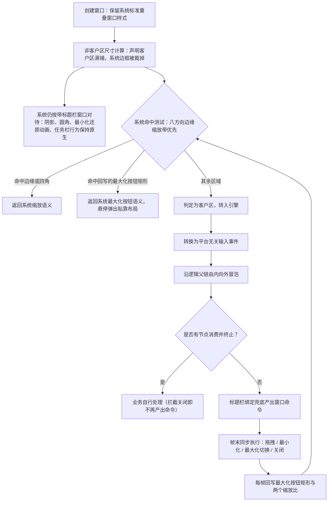
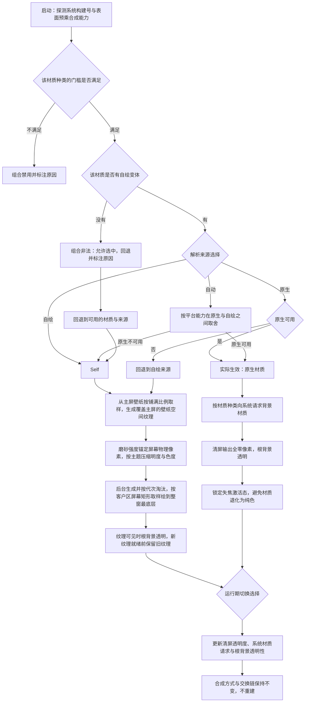

# 平台与窗口集成

## 1. 核心问题与定位
自绘 GPU UI 框架如果脱离操作系统原生窗口机制，就会失去系统级体验——窗口不能边缘缩放、不支持系统贴靠布局、输入法候选框位置错乱；而如果反过来把交互全部交还系统，业务又无法拦截“关闭前先确认未保存”这类需求。本模块定义引擎与操作系统窗口层之间的桥梁，并划清“哪些交互交还系统、哪些交互必须留在引擎”的边界。

## 2. 核心概念模型
- **裁切式无边框窗口**：窗口仍按系统标准重叠窗口创建（保留标题与边框能力位），再由引擎在非客户区尺寸计算阶段声明“客户区满铺”，把系统边框在视觉上整体裁掉。系统依旧认为这是一扇带标题栏的窗口，因此阴影、圆角、最小化与还原动画、任务栏与切换器行为全部保持原生。
- **双尺度坐标**：界面坐标系带“合成缩放”（显示器物理缩放乘以用户可调界面缩放），窗口坐标系带“显示器缩放”。逻辑视口由物理客户区尺寸除以合成缩放得出，字形光栅化与渲染相机统一按合成缩放映射回物理像素，命中矩形则按合成缩放与显示器缩放之比换算后与系统命中区域对齐。
- **窗口几何消息合并与模态即时帧**：窗口拖拽移动或调整尺寸期间，队列中连续到达的窗口位置变更、尺寸变更与指针移动事件各自只保留最新一项；在操作系统模态移动/缩放循环阻塞期间，收到位置或尺寸变更时走同一个即时帧泵直接驱动单帧同步重绘，避免退出拖拽后逐帧回放整条历史几何轨迹，造成松手后的位置突跳或慢动作缩放。
- **命中区域回写**：引擎每帧只把**最大化按钮**的矩形换算后回写窗口层，其余窗口控制按钮一律回写空矩形，使其保持在客户区、由引擎自主派发。
- **输入法事件桥接**：平台层只上报系统输入法的“组合中 / 提交 / 取消 / 启用状态”，不缓存待提交文本；组合串与提交串都进入同一份编辑状态归约，组合期间的光标与选区由该状态自行推导。
- **窗口命令队列**：拖拽、最小化、最大化切换、关闭四类意图以命令形式在帧内排队，由窗口宿主在帧末统一执行；命令的唯一产出方是引擎的冒泡兜底，平台层不再按坐标二次判定。
- **多窗口与穿透覆盖层**：支持多窗口生命周期管理，以及根据每帧交互区域动态切换“鼠标捕获”与“透明穿透”的工具浮窗。
- **材质种类与来源两轴正交的后景模型**：后景由两个彼此独立的维度共同决定——「材质种类」描述看起来是什么（无、跟随系统、标准云母、云母变体、亚克力、沉浸式后景），「来源」描述由谁把它画出来（系统合成器直接生成，或引擎自绘壁纸纹理）。同一材质可以有两种来源，观感应当接近但能力前提与失效条件不同；材质种类为「无」时来源轴折叠，不请求任何系统材质也不生成纹理。交换链的合成方式在启动时按平台能力一次性固定：能力可用即预乘 alpha，否则不透明；之后不再随选择变化。客户区清屏输出全零像素时系统材质才能透出，非原生来源则用不透明清屏保持视觉不透明。平台硬限制是预乘合成与呈现缩放不能共存，因此具备原生能力的机器整条生命周期放弃呈现缩放请求，接受调整窗口尺寸过渡帧可能被拉伸的代价。自绘来源沿用后台后景子系统：从主屏壁纸按铺满比例取样、降采样磨砂，再按主题压缩明度与色度生成**壁纸空间纹理**；应用层负责后台生成、代次淘汰与纹理资产提交。
- **材质组合的可用性判定与回退**：用户只表达“想要哪种材质、想要哪条来源”，宿主结合平台能力把选择解析为唯一实际组合，并向页面暴露实际组合、清屏透明度、根背景透明性与回退原因。可用性按材质种类逐档声明：多数材质要求系统构建号不低于 22621（通过系统内核版本接口探测，非系统环境或探测失败视为未知）**且**图形表面支持预乘合成；沉浸式后景额外要求构建号不低于 26100，属公开文档未收录的实验档。机器能力不足时该组合禁用并标注原因；组合本身非法（该材质没有自绘变体）时允许选中，由宿主回退并在读出面板说明回退结果与原因。无头与非系统环境同样保持自绘来源。

## 3. 原生消息与引擎桥接流程

### 材质组合的启动解析与运行期切换

自绘纹理与窗口解耦：纹理覆盖整块主屏并按铺满比例生成，窗口只通过客户区屏幕矩形计算 UV 子矩形取自己那一块。窗口移动或缩放只改变 UV，不重新解码壁纸；只有主屏尺寸、DPI 缩放、主题、材质配方或壁纸源发生变化时，旧纹理才失效并进入下一代生成。部分越界时 UV 按主屏边界钳制，完全无交集时退回整张纹理，保证采样区域始终有效。磨砂强度以屏幕物理像素为基准，与壁纸分辨率、屏幕分辨率无关：同一台机器上换壁纸只改变色调与构图，不改变磨砂观感。

## 4. 关键设计取舍
- **保留系统标题栏能力位再裁切，优于弹出式无边框窗口**：完全无边框的弹出式窗口拿不到系统阴影与圆角，最小化与还原动画退化为硬切，任务栏与切换器行为也会异常。代价是必须准确回应非客户区尺寸计算，任何偏差都会残留一条系统边框或让客户区溢出。
- **只交还最大化按钮，优于交还整条标题栏**：系统贴靠布局只认“命中测试返回最大化按钮语义”这一个钩子，因此回写一个矩形即可，其余按钮留在客户区由引擎派发，业务才有机会拦截关闭。代价是最小化与关闭丧失系统默认的按下反馈，必须由引擎自绘悬停态与按下态。
- **命令化产出优于平台直接夺取**：拖拽与双击最大化不再由窗口层按坐标猜测，而是冒泡全程无人拦截时兜底排队成命令。业务在任意祖先返回终止即可改变行为，也不存在“平台判一次、引擎再判一次”的双份命中在缩放边界处互相矛盾。代价是拖拽启动被推迟到本帧事件处理末尾。
- **双尺度显式换算**：早期直接把界面坐标当作窗口逻辑坐标回写，在 1.25 倍界面缩放的机器上，热区会整体偏移约四个按钮宽度，贴靠菜单在标题栏中部弹出。换算公式下沉为单一公开入口，避免各调用点各自乘一个系数。
- **Win11 原生优先、Win10 自绘回退，优于仅自绘**：Win11 的系统云母由合成器直接采样壁纸，零后台解码、零纹理内存，窗口移动与失焦时材质表现由系统维护；代价是原生能力可用的机器整条窗口生命周期都固定为预乘合成并放弃呈现缩放参数，且必须按操作系统构建号判定可用性。Win10 等不支持原生路径的环境继续用壁纸派生纹理自绘，完全可控、跨窗口一致，也能在拿不到静态壁纸时确定性回退纯色底。
- **材质种类与来源两轴正交，优于拍平成单一枚举**：拆开之后，“系统原生”与“引擎自绘”不再互相排斥，“系统不支持某种材质”与“某种材质没有自绘变体”成为两类可分别处理的不可用原因，界面也能分别给出“禁用并说明”与“允许选中并回退”两种处理。代价是模型里多了一层组合，宿主接受的是组合而非单一选择，界面必须同时呈现两个维度。

## 5. 边界与不变量
- **最小化与关闭绝不回写**：只允许最大化按钮的矩形进入系统命中测试。一旦回写关闭按钮，系统会把点击转成非客户区按钮抬起并直接关窗，应用层永久失去拦截能力。
- **标题栏高度必须归零**：引擎不得再向窗口层声明“标题栏高度”，否则系统会在该条带直接夺取拖拽，与冒泡兜底重复触发，表现为拖拽抖动或双击最大化连点。
- **命中矩形必须按双尺度换算**：任何新增回写矩形都走同一换算入口，且矩形为零时等价于“不交还”，禁止用近似屏幕坐标硬编码。
- **边缘缩放优先于覆盖层穿透**：系统非客户区命中测试中，窗口按钮与八方向边缘缩放判定必须优先于覆盖层透明穿透策略，否则窗口将无法缩放或关闭。
- **无障碍语义桥接**：引擎产出的界面语义树必须实时同步到操作系统无障碍接口，保证读屏器与辅助工具可正常工作。
- **合成方式在窗口生命周期内固定**：启动时只按原生能力选择一次表面合成方式（能力可用即预乘，否则不透明），此后任何材质种类或来源的切换都不得改变它。切换只更新清屏透明度、系统材质请求与根背景透明性；透明性翻转绝不触发交换链重建。能力可用的机器即使当前选择非原生来源或无材质，也保持预乘合成并用不透明清屏保持视觉不透明，从而避免往返切换时重配整条呈现链而闪黑。
- **后景可见时根背景必须透明**：自绘纹理可见**或**实际生效来源为原生时，根背景（清屏色）必须透明，任何不透明底色都会盖住后景。自绘来源按代次替换纹理，新纹理就绪前保留旧纹理，禁止中途闪回纯色底；原生来源的清屏不透明度为零，且主题切换只能更新表面原色、不得恢复不透明。
- **材质种类与来源必须同时可见**：界面必须同时呈现用户选择的材质种类与来源，以及实际生效的组合。只显示其中一维会让使用者误判，例如选了云母变体却落在自绘来源上。
- **不可用原因由后景计划给出**：界面不得自行推导组合是否可用，也不得凭自身状态猜测系统支持情况。机器能力不足时该组合禁用并标注原因；组合本身非法时允许选中，但必须显示回退结果与原因。
- **磨砂强度锚定屏幕物理像素**：自绘磨砂强度的基准是屏幕物理像素，不得回退为壁纸像素语义——后者会让观感随壁纸与屏幕分辨率漂移，使同一台机器上的效果无法复现。
- **输入法组合只有一份权威文本**：组合中的字符串必须写入真实的编辑缓冲区并参与光标、选区与撤销快照；平台层与宿主都不得缓存待提交文本，否则提交时会出现重复插入或组合串丢失。
- **次级窗口始终不透明**：多窗口中的次级窗口不参与后景模式，交换链保持不透明合成，渲染前临时恢复不透明清屏、结束后还原主窗口设置。
- **自绘纹理属于壁纸空间，不属于窗口**：纹理必须覆盖整块主屏并按铺满比例生成，禁止按窗口尺寸重新生成；窗口只按客户区屏幕矩形取 UV 子矩形。移动或缩放窗口只能更新 UV，主屏尺寸、DPI、主题、纹理分辨率上限与壁纸源变化才允许使纹理失效。UV 必须钳制到主屏范围，且布局视口不得混入屏幕坐标。
- **根背景与 UV 必须同帧生效**：窗口移动后，锚点、后景计划与场景重建必须在同一帧完成；只更新纹理取样而漏掉根背景透明性，会让旧底色短暂盖住后景。
- **模态移动与缩放共用即时帧泵**：模态期间的位置变化与尺寸变化必须走同一个即时帧泵出帧，禁止只对尺寸变化直通重绘、把位置变化留到拖拽结束才消费，否则后景会在松手瞬间突跳。平台层只按系统消息出帧、不感知后景模式；积压的位置事件合并为最新一条，任意时刻队列中最多保留最后一次真实窗口位置。
