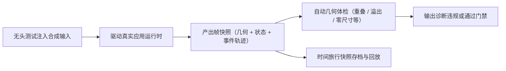

# 无头验证与展台

## 1. 核心问题与定位
GUI 应用最难测的不是“算术对不对”，而是“界面有没有重叠、文字有没有溢出、按钮点下去焦点跑没跑飞”。如果只能靠人工打开窗口肉眼点点看，回归成本极高。本模块提供脱离真实窗口和 GPU 的无头验证体系，以及集成了全套能力的交互式展台。

## 2. 核心概念模型
- **无头测试工具**：在完全没有显示器和 GPU 的环境下，驱动同一套应用运行时，注入合成的鼠标、键盘、滚轮和窗口事件，并采集完整的帧快照。
- **五项自动几何体检**：对每帧快照自动运行结构与几何规则检查，自动捕获**节点重叠、容器溢出、零尺寸异常、文本截断以及越界绘制**。
- **时间旅行快照**：把任意历史帧的完整世界状态零拷贝序列化保存，支持在调试或测试中瞬间回放到任意历史帧状态。
- **自举展台**：使用本框架自身构建的综合展示与实验室应用，同时承担“设计规范落地验证”“全量组件门禁”与“性能基准可视化”三重角色。

## 3. 无头验证与开发闭环

## 4. 关键设计取舍
- **同一套运行时，双端驱动**：无头测试与真实桌面窗口驱动完全相同的应用生命周期与事件归约逻辑，保证无头测试测出来的交互、冒泡与焦点行为与真机运行 100% 一致。
- **检查器脱离布局树**：内置调试检查器直接向最高优先级调试通道绘制，开关检查器或查看盒模型与事件冒泡轨迹时，绝对不会触发主界面重新排版。

## 5. 边界与不变量
- **组件展台覆盖率红线**：所有注册在标准目录中的组件，必须 100% 在展台中以可交互形式出现，并经过形态恒定与几何体检验证。
- **无头环境零图形依赖**：无头验证链路不得依赖物理显示器或 GPU 驱动，必须能在纯命令行与持续集成环境中稳定运行。
