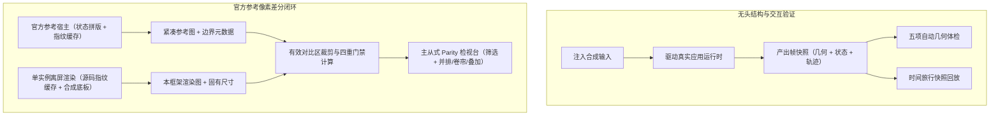

# 无头验证与展台

## 1. 核心问题与定位
GUI 应用最难测的不是“算术对不对”，而是“界面有没有重叠、文字有没有溢出、按钮点下去焦点跑没跑飞、画出来的控件跟系统原生到底像不像”。如果只能靠人工打开窗口肉眼点点看，回归成本极高。本模块提供脱离真实窗口和 GPU 的无头验证体系、自举展台，以及面向官方参考系统的批量像素差分闭环与主从式像素对照检视台。

## 2. 核心概念模型
- **无头测试工具**：在完全没有显示器和 GPU 的环境下，驱动同一套应用运行时，注入合成的鼠标、键盘、滚轮和窗口事件，并采集完整的帧快照。
- **五项自动几何体检**：对每帧快照自动运行结构与几何规则检查，自动捕获**节点重叠、容器溢出、零尺寸异常、文本截断以及越界绘制**。
- **时间旅行快照**：把任意历史帧的完整世界状态零拷贝序列化保存，支持在调试或测试中瞬间回放到任意历史帧状态。
- **自举展台**：使用本框架自身构建的双层工作台应用（控件画廊 + 引擎实验室），按三大域（首页导览 / 10 大功能分类组件目录 / 引擎与设计实验室）与三套页面模板（落地页、分类索引页、工坊详情页）组织，同时承担“设计规范落地验证”“全量组件门禁”与“性能基准可视化”三重角色。
- **控件分类元数据**：挂载在 `WidgetCatalogId` 上的穷举编译期元数据（10 类 `ControlCategory` 与三层 `ControlOrigin`：`WinUi3` / `Toolkit` / `Unbound`），是导航树、分类索引网格与覆盖率门禁的唯一事实源。
- **官方参考截图宿主**：独立编译的官方控件采集器，在固定强调色、确定性文案与指定合成底板下，将同一控件的多个状态排入单张拼版图集，经一次动画收敛后切出紧凑单图与边界元数据，并通过版本与规格指纹实现增量缓存。
- **有效对比区像素差分**：展台的差分模块复用单实例离屏渲染器，按相同边界与合成底板渲染本框架对应控件，并在双方内容包围盒与布局边界并集构成的**有效对比区**内执行四重门禁（内容包围盒、固有尺寸、局部色差均值/分位数、显著色差像素占比），结合源码哈希指纹跳过未改动组件的重复渲染。
- **像素对照检视台（Parity Inspector）**：展台内嵌的主从式审阅界面，左侧提供带计数的状态筛选胶囊（存在失败项时默认聚焦失败/无效项）、关键词与主题/后景过滤及按 ΔE 降序排列的紧凑列表，右侧提供并排（Side-by-Side）、卷帘（Curtain，鼠标跟随与点击锁定）与叠加（Overlay）三种对比视图及像素倍放舞台。

## 3. 无头验证与像素差分闭环

## 4. 关键设计取舍
- **同一套运行时，双端驱动**：无头测试与真实桌面窗口驱动完全相同的应用生命周期与事件归约逻辑，保证无头测试测出来的交互、冒泡与焦点行为与真机运行一致。
- **三套页面模板与一控件一详情页**：落地页、分类索引页与工坊详情页各司其职，避免首页被迫套入带旋钮与代码折叠条的示例外框；废除把全部目录控件塞进同一超长滚动页的做法，借助可折叠 `NavigationView` 树与逐页无头遍历保证导航直观且门禁严格。
- **状态拼版与单实例复用**：把同一控件多状态的动画收敛等待合并为单次拼版截图，并在本框架侧全程复用同一个离屏渲染器实例，避免随主题、后景与状态维度扩展产生线性启动开销。
- **有效对比区裁剪而非全画布平均**：只对控件本体及阴影、焦点环覆盖的紧凑并集区域统计色差，杜绝大面积一致背景稀释局部视觉缺陷。
- **合成底板隔离桌面环境噪声**：在控件级批量差分中使用固定可复现的纯色、云母与亚克力合成底板检验半透明画刷叠色，把依赖真实桌面窗口合成的检验留给独立的屏幕捕获基线。

## 5. 边界与不变量
- **组件展台覆盖率红线**：所有注册在标准目录中的组件，必须在编译期声明分类与来源元数据，并在展台对应单控件详情页中以真实发射器可交互呈现，逐页通过形态恒定与几何体检验证。
- **三类组件分级治理**：基准对齐控件受有效对比区四重门禁约束；自有独有控件不绑定一对一外部截图，但必须满足从基准对齐控件提炼出的统一家族视觉与交互规律。
- **无头环境零图形依赖**：无头几何验证链路不得依赖物理显示器，必须能在纯命令行与持续集成环境中稳定运行。

## 6. 面向宿主应用的四级测试分层（ADR-0045）

除框架内部自举展台与参考控件像素差分外，`unbound-ui` 为所有宿主应用提供清晰的四级测试分层：

| 层级 | 名称 | 核心能力与依赖 | 典型抓虫范围 |
| :--- | :--- | :--- | :--- |
| **L1** | 逻辑单测 | 无 UI 运行时、无 GPU | 数学公式、状态机、数据解析与持久化 |
| **L2** | 无头交互 | 驱动 `AppRuntime` 与 `unbound-headless` 五项几何体检，零 GPU | 事件冒泡、焦点路由、节点重叠/溢出/截断 |
| **L3** | 离屏渲染 | `unbound_app::testing::OffscreenTestHarness`（无窗口/无交换链，共享无头 Vulkan + 软光栅兜底），接通 `on_before_render`、`AssetHub` 与 `CustomViewportPass` | 外部纹理未上屏、Z 序遮挡、空白画面、裁剪与像素漂移 |
| **L4** | 真机窗口 | 真实系统窗口与桌面合成器 | Win32 IME（`VK_PROCESSKEY`）、多窗拖出停靠、OLE、托盘与 DWM 合成 |
