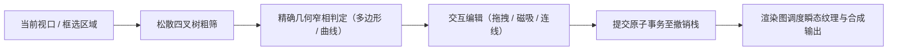

# 无限画布与节点图

## 1. 核心问题与定位
在节点编辑器、白板或设计工具等场景中，画布可能容纳数十万个自由分布的节点与连线，且伴随频繁的平移、缩放、框选与撤销重做。传统的树形流式排版无法胜任此类空间自由度，需要专门的空间索引与计算图架构。

## 2. 核心概念模型
- **分块世界坐标**：采用大尺度分块坐标体系处理无限画布平移，避免单精度浮点数在远离原点时出现抖动与精度丢失。
- **松散四叉树**：用于管理画布上百万级实体的空间边界，使视口粗筛与框选查询保持在极低耗时。
- **事务式撤销与磁吸对齐**：将拖拽、连线、批量移动打包为原子事务；移动节点时基于邻近边界自动计算对齐参考线与磁吸吸附。
- **渲染图**：负责编排离屏渲染通道与瞬态纹理池的复用，支撑节点预览、滤镜合成等复杂图元输出。
- **大图瓦片金字塔**：面向超高分辨率画布资产提供纯计算多级细节调度器，依据当前视口缩放比自动选择目标细节层级、按邻域预取并按预算淘汰离屏瓦片，输出与底层图形上传解耦的加载与释放计划。

## 3. 画布查询与编辑流程

## 4. 关键设计取舍
- **松散四叉树替代严格四叉树**：严格四叉树在物体跨越象限分割线时必须不断向下分裂或复制引用；松散四叉树允许节点边界适度外扩，大幅减少了动态拖拽时的树结构调整开销。
- **与常规 UI 共享拾取与渲染底座**：画布层与常规 UI 层复用同一套底层图元提交与拾取管线，仅在图层优先级上处于 UI 控件层之下，实现“画布背景 + 悬浮工具栏”的无缝融合。

## 5. 边界与不变量
- **画布与 UI 职责分离**：无限画布负责自由二维空间与拓扑连线，流式面板与菜单仍交由标准 UI 布局系统处理，不混用两套排版规则。
- **事务原子性**：任何多节点批量操作必须支持单步完整撤销与重做，不可留下半截孤立状态。
- **瓦片调度与上传解耦**：瓦片金字塔调度器只负责纯计算层级选择、可见性裁剪与缓存淘汰策略，不直接持有图形设备或执行阻塞磁盘解码，由应用层按帧对接托管外部纹理槽完成流式上传。
