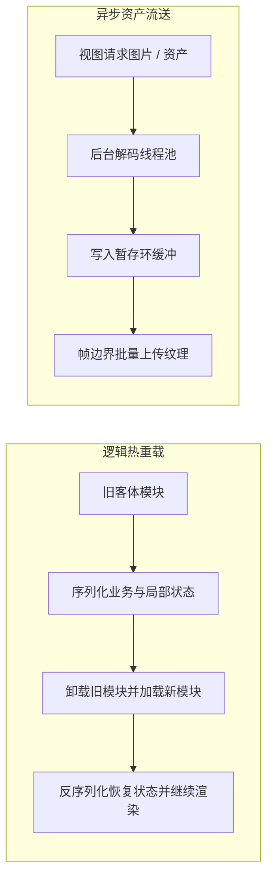

# 热重载与资产流送

## 1. 核心问题与定位
在大型桌面应用或工具开发中，每次修改界面代码都重启整个进程会打断调试上下文；同时，高分辨率图片、着色器或字体等外部资产若在主线程同步解码，会造成明显的画面卡顿。本模块解决“逻辑热替换不断流”与“重资产异步零卡顿流送”两个问题。

## 2. 核心概念模型
- **宿主与客体隔离**：将长生命周期的底层资源（窗口、GPU 设备、线程池、全局内存池）留在“宿主”进程核心，将易变的界面与业务逻辑编译为可动态替换的“客体”模块。
- **稳定跨边界协议与状态迁移**：宿主与客体之间仅通过扁平、版本化的协议交换数据；重载发生时，通过统一序列化协议将客体状态快照保存并在新模块加载后恢复（或按契约迁移）。
- **暂存环交接**：后台线程池完成图片解码后，先写入暂存缓冲区，待帧边界统一交接给 GPU 纹理图集，主线程全程无锁等待。

## 3. 热重载与异步资产流送流程

## 4. 关键设计取舍
- **动作即数据支撑热重载**：正因为交互动作与状态都是纯数据而非悬挂在旧动态库里的函数指针，热重载时才不会出现“旧闭包指向已卸载内存”的崩溃问题。
- **内存分配与资源归宿主托管**：客体模块不直接持有长期的 GPU 句柄或系统窗口句柄，避免模块卸载时发生资源泄漏。

## 5. 边界与不变量
- **跨边界只传扁平数据**：宿主与客体接口严禁传递带有内部布局依赖的高级语言对象，所有跨界数据必须有明确的内存布局契约。
- **解码不得阻塞渲染线程**：任何图像解码或磁盘资产读取必须在后台完成，主线程仅在数据就绪后执行轻量的批量上传。
