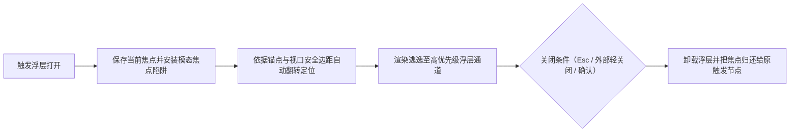

# 组件与浮层

## 1. 核心问题与定位
随着业务增长，团队很容易在各个页面私自拼装散落的“野生控件”，导致样式不一致、状态生命周期失控、或者弹窗被外层滚动容器裁剪掉。本模块确立标准组件目录规范、局部状态生命周期以及浮层的逃逸机制。

## 2. 核心概念模型
- **单一标准组件目录**：所有通用交互组件必须注册在统一的组件目录中；重叠能力（如普通滑块与区间滑块、普通输入框与只读复制框）通过描述符配置合并，禁止另起炉灶维护旁路组件库。
- **形态恒定原则**：同一组件在空闲、悬停、按下、聚焦、禁用等不同交互状态之间切换时，输出的图元拓扑结构保持恒定（只变属性不增减图元），使场景差分只需做轻量局部更新。
- **逻辑归属与渲染逃逸**：下拉菜单、Tooltip、模态框等浮层在**逻辑树中依然挂在触发它的父节点下**（继承主题与焦点组），但在**渲染层级与拾取排序上逃逸到独立的浮层通道**，从而摆脱父容器裁剪并盖在所有页面之上。
- **标题栏是一等标准组件**：三段式标题栏（左插槽 / 标题 / 右插槽）叠加三个等宽窗口控制按钮，全部由组件目录提供。它只声明外观与插槽，**不调用任何窗口接口**；拖拽、最小化、最大化切换与关闭统一由冒泡兜底产出窗口命令。
- **背景带的最低优先级命中区**：标题栏空白处由一个纯装饰控件发射最低层级的命中区，只充当冒泡起点而不拦截，因此页面上任何正常控件都天然压在它之上。
- **外壳与展厅组合层**：除“单个控件”外，还有一类**跨页面复用的外壳积木**（几何矢量图标、图标按钮、品牌徽标、侧边栏分组标题与导航项、特性入口卡片、首屏横幅背景）。它们以 `unbound_widgets::shell` 模块整体提供，由 `unbound-app` 的 `ViewBuilder`（`shell_icon` / `icon_button` / `brand_badge` / `sidebar_section` / `sidebar_item` / `feature_card` / `stage_box` / `showcase_card` / `page_header`）与展台、启动器共同组合。这类积木不进入 `WidgetCatalogId`：一个组合层模块往往同时提供多个描述符，若逐个登记会让控件词汇表的数量契约失真；它们同样受“形态恒定”约束，由展台的无头测试直接覆盖其跨状态图元数量。
- **整栏侧边栏是一等标准组件**：面板底色与描边、分组小节、条目胶囊、尾部徽标与页脚固定项收敛为同一个组件条目，由同一份垂直排版结果驱动绘制、命中切分与无障碍子节点。选中项与悬停项分别由描述符的“激活标识”与“悬停标识”给出，二者可以同时落在不同行——因此“一条选中 + 另一条悬停”只是两次字段变更，而不是两套互斥状态机。

## 3. 浮层生命周期与防溢出定位

## 4. 关键设计取舍
- **描述符即配置，状态归运行时池**：组件本身是轻量无状态的纯数据描述符，交互产生的瞬态（如输入文本、滑块拖拽、滚动偏移）由运行时按稳定键统一托管，并在节点离开视图树时自动触发卸载回收。
- **浮层自动避让视口边界**：Tooltip 与弹出菜单在布局阶段自动检测与窗口边缘的距离，空间不足时自动向对侧翻转并做安全边距钳制，避免内容被窗口切掉。
- **形态恒定只管交互态**：悬停、按下、聚焦、禁用之间只变属性不增减图元；而语义状态切换（如最大化 ↔ 还原）允许更换图元拓扑，因为它不属于同一段交互序列，强行复用反而会让还原图标出现遮挡色块。

## 5. 边界与不变量
- **目录全覆盖原则**：所有标准组件必须在组件展台中提供可交互演示，不存在未收录的孤立控件；外壳与展厅组合层的积木同样必须在展台中可见，只是以组合场景而非独立目录条目的形式出现。
- **单行文本必须自带宽度约束**：文本排版只按矩形原点输出字形，既不换行也不裁切；任何把文案放进固定宽度行内的组合控件（如特性卡片的标题/副标题）必须在发射前按可用宽度做省略号截断，否则长文案会压到同一行右侧的装饰图元上。
- **整栏组件不得内建滚动**：侧边栏只渲染落在自身矩形内的行，放不下的内容由调用方通过调整矩形高度或切换折叠模式处理。内建滚动会让场景形状随滚动位置变化，破坏“只修补变化切片”的前提，也让滚动状态出现两份互相竞争的持有者。
- **共享一行的左右分栏禁用按百分比定宽**：标题列若使用 `width: 100%` 与右侧操作区共享同一个 `row`，会把操作按钮挤出可视区；必须改用弹性填充（`flex_grow = 1` 且最小宽度 `0`）。
- **焦点归还与陷阱契约**：模态浮层打开时严禁键盘焦点逃逸到背景层；浮层关闭后必须将焦点精确归还给打开它的触发元素。
- **可点击控件必须消费按下**：任何按钮、输入框、搜索框在按下阶段必须消费事件。漏消费会让事件继续冒泡到标题栏背景带，被兜底解释成一次窗口拖拽，用户看到的现象是“点按钮却把窗口拖走了”。
- **组件不得直接操作窗口**：标题栏与窗口控制按钮只表达意图，禁止在组件内部调用平台接口，否则业务的拦截逻辑将无法生效。
