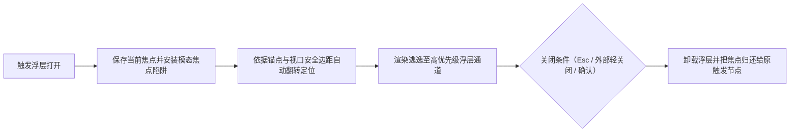

# 组件与浮层

## 1. 核心问题与定位
随着业务增长，团队很容易在各个页面私自拼装散落的“野生控件”，导致样式不一致、状态生命周期失控、或者弹窗被外层滚动容器裁剪掉。本模块确立标准组件目录规范、局部状态生命周期以及浮层的逃逸机制。

## 2. 核心概念模型
- **单一标准组件目录**：所有通用交互组件必须注册在统一的组件目录中；重叠能力（如普通滑块与区间滑块、普通输入框与只读复制框）通过描述符配置合并，禁止另起炉灶维护旁路组件库。
- **形态恒定原则**：同一组件在空闲、悬停、按下、聚焦、禁用等不同交互状态之间切换时，输出的图元拓扑结构保持恒定（只变属性不增减图元），使场景差分只需做轻量局部更新。
- **逻辑归属与渲染逃逸**：下拉菜单、Tooltip、模态框等浮层在**逻辑树中依然挂在触发它的父节点下**（继承主题与焦点组），但在**渲染层级与拾取排序上逃逸到独立的浮层通道**，从而摆脱父容器裁剪并盖在所有页面之上。

## 3. 浮层生命周期与防溢出定位

## 4. 关键设计取舍
- **描述符即配置，状态归运行时池**：组件本身是轻量无状态的纯数据描述符，交互产生的瞬态（如输入文本、滑块拖拽、滚动偏移）由运行时按稳定键统一托管，并在节点离开视图树时自动触发卸载回收。
- **浮层自动避让视口边界**：Tooltip 与弹出菜单在布局阶段自动检测与窗口边缘的距离，空间不足时自动向对侧翻转并做安全边距钳制，避免内容被窗口切掉。

## 5. 边界与不变量
- **目录全覆盖原则**：所有标准组件必须在组件展台中提供可交互演示，不存在未收录的孤立控件。
- **焦点归还与陷阱契约**：模态浮层打开时严禁键盘焦点逃逸到背景层；浮层关闭后必须将焦点精确归还给打开它的触发元素。
