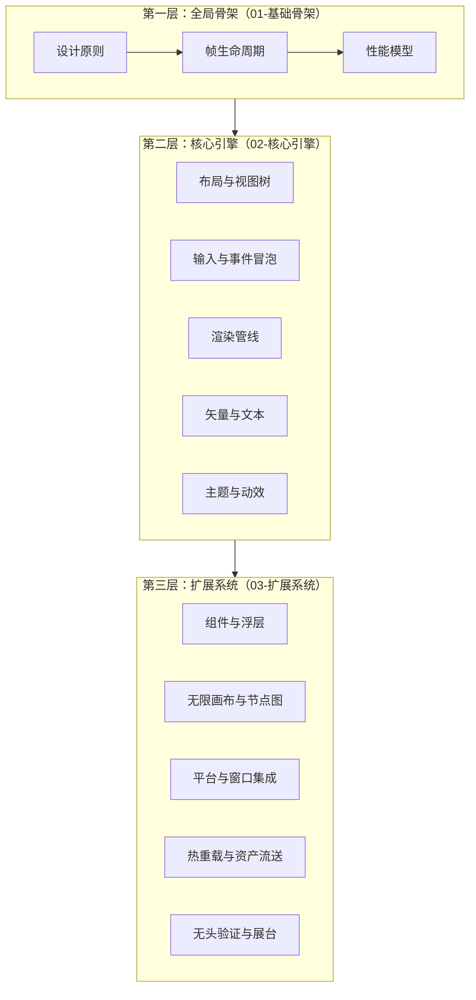

# Unbound UI 架构总览

Unbound UI 是一套面向桌面端的高性能图形界面框架，核心目标是把**声明式 UI 的开发直觉**与**GPU 原生渲染的确定性性能**结合在一起：静止时零空转、交互时微秒级响应，并支持跨进程/热重载与无头自动化验证。

整套架构按“从宏观骨架到具体子系统”分为三层，推荐按以下顺序阅读：

## 阅读导航

### 第一层：全局骨架（建立整体心智模型）
- [设计原则](./01-基础骨架（foundations）/设计原则（design-principles）.md)：系统的分层边界、数据驱动哲学与不可打破的全局红线。
- [帧生命周期](./01-基础骨架（foundations）/帧生命周期（frame-lifecycle）.md)：一帧从外部输入到状态归约、增量排版、场景构建再到屏幕呈现的完整闭环。
- [性能模型](./01-基础骨架（foundations）/性能模型（performance-model）.md)：静止零功耗、三级脏标记分流与关键预算控制。

### 第二层：核心引擎（理解 UI 如何工作与绘制）
- [布局与视图树](./02-核心引擎（core-engine）/布局与视图树（layout-and-tree）.md)：保留模式节点树、重排边界截断与视口虚拟化。
- [输入与事件冒泡](./02-核心引擎（core-engine）/输入与事件冒泡（input-and-bubbling）.md)：空间拾取、高频零冒泡与离散事件逻辑父链冒泡、焦点与无障碍。
- [渲染管线](./02-核心引擎（core-engine）/渲染管线（rendering-pipeline）.md)：GPU 驱动剔除、多图元合批、裁剪与解析阴影。
- [矢量与文本](./02-核心引擎（core-engine）/矢量与文本（text-and-vector）.md)：解析曲线、多语言文本排版与图集管理。
- [主题与动效](./02-核心引擎（core-engine）/主题与动效（theme-and-motion）.md)：语义颜色查找表、三层缩放与临界阻尼物理弹簧。

### 第三层：扩展系统（应用能力、平台与工程验证）
- [组件与浮层](./03-扩展系统（subsystems）/组件与浮层（widgets-and-overlays）.md)：标准组件目录、局部状态隔离与浮层逃逸模型。
- [无限画布与节点图](./03-扩展系统（subsystems）/无限画布与节点图（canvas-and-graph）.md)：海量实体的空间索引、事务撤销与渲染图调度。
- [平台与窗口集成](./03-扩展系统（subsystems）/平台与窗口集成（platform-integration）.md)：原生无边框窗口、边缘缩放、系统输入法与文件拖放。
- [热重载与资产流送](./03-扩展系统（subsystems）/热重载与资产流送（hot-reload-and-assets）.md)：宿主与客体隔离、状态迁移与异步纹理流送。
- [无头验证与展台](./03-扩展系统（subsystems）/无头验证与展台（verification-and-showcase）.md)：无头几何体检、时间旅行快照与自举展台体系。
