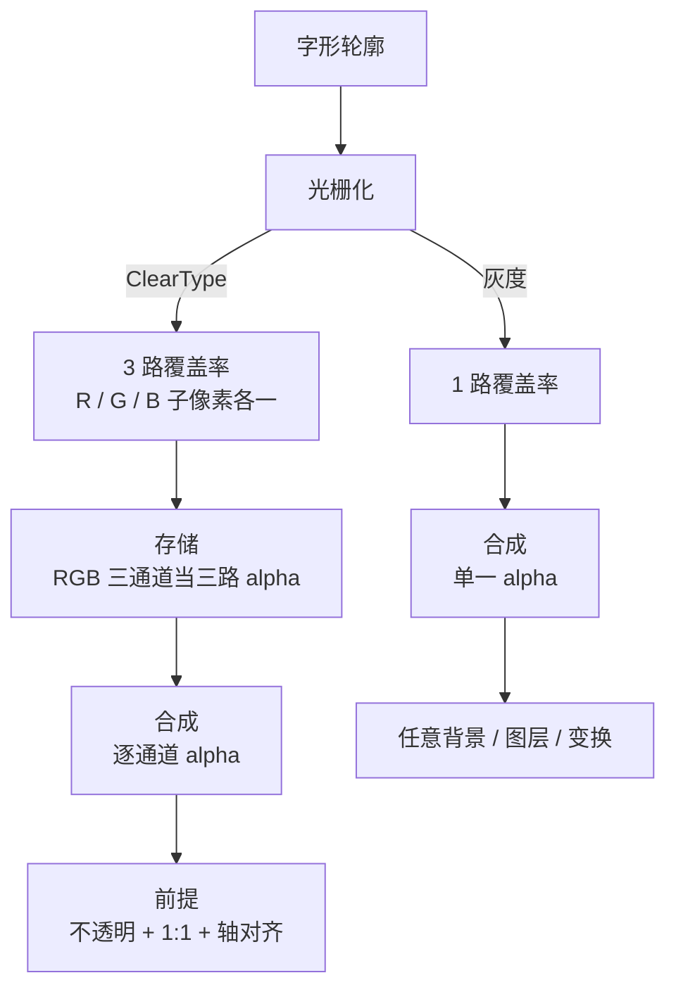

# ClearType 与亚像素抗锯齿

- 日期：2026-11-19
- 读者：不熟悉文字渲染的实现者与设计者，无需预先了解 DirectWrite 或字体光栅化
- 时效：涉及版本与产品行为的结论以 2026-11 为准；Chromium、Qt 的细节来自公开源码与文档，升级依赖前应复核
- 项目内的决策与落地见 ADR 0013

## 1. 先说结论

1. ClearType 不是"更高质量的灰度抗锯齿"，而是**三路覆盖率、逐通道混合、1:1 物理像素**三件事的绑定。缺任何一条，效果都不成立。
2. 它不能用于透明中间层，原因是表示能力：一个像素只有一个 alpha，而 ClearType 有三个独立覆盖率。微软文档原文明确写了这一点。这不是实现缺陷，是信息表示的上限。
3. 因此它与分层合成、半透明材质、画布缩放、旋转动画天然冲突。WinUI 3、Chromium 的 GPU 合成路径、Qt Quick、macOS 都因此转向灰度。
4. 但需求没有消失：小字锐度、字距均匀、字重正确、任意缩放仍然要解决，只是换了手段——高 PPI、亚像素定位、gamma 与字干补偿、SDF/MSDF、GPU 路径渲染。

## 2. 名词与边界

理解这一切的前提是一个物理事实：LCD 屏幕上的一个"像素"并不是一个方块，而是由红、绿、蓝三个竖直的条（子像素）并排组成。正常显示时三者亮度相同，眼睛把它们合成为白或灰；**子像素抗锯齿就是让这三个条各自显示不同的亮度，分别承担一部分边缘覆盖率**，等于把水平方向的有效分辨率提高到三倍，代价是边缘会出现彩色纹路。

| 名词 | 含义 | 是否产生彩边 | 是否依赖 1:1 |
| --- | --- | --- | --- |
| 子像素抗锯齿（ClearType / LCD text） | 用 RGB 三个物理子像素分别承载覆盖率，提高水平方向的有效分辨率 | 是 | 是 |
| 亚像素定位（subpixel positioning） | 字形允许落在 1/8–1/16 px 的非整数位置上，避免字距抖动 | 否 | 否 |
| 灰度抗锯齿 | 每个像素一个覆盖率，与背景做单 alpha 混合 | 否 | 否 |
| 网格拟合（grid fitting / hinting） | 把笔画对齐到整像素网格，低分辨率下更实，但会破坏小数定位 | 否 | 否 |
| 距离场（SDF / MSDF / MTSDF） | 存"到字形边缘的距离"而不是覆盖率，采样时重建边缘 | 否 | 否 |

最常见的误读是把前两项混为一谈，得出"亚像素技术已经过时"的结论。**退场的是子像素抗锯齿，亚像素定位比过去更普遍**——DirectWrite 的 `baselineX` 小数偏移、各类框架按 1/4 或 1/8 px 分档缓存字形，都属于后者。

另有一个命名陷阱：DirectWrite 的 `DWRITE_TEXTURE_ALIASED_1x1` 里的 "ALIASED" 指的是"单通道、不使用子像素配色"，输出仍是 8 位灰度覆盖率，不是 1 位黑白位图。

## 3. 工作机制：三件事的绑定

ClearType 不是"一个算法"，而是一条链上的三个环节。下面拆开看，每个环节各有一条硬性要求，三条同时满足才成立。



### 3.1 生成

调用方给 `CreateGlyphRunAnalysis` 传 `DWRITE_TEXT_ANTIALIAS_MODE_CLEARTYPE`，再按 `DWRITE_TEXTURE_CLEARTYPE_3x1` 取纹理，得到每像素 3 字节：分别是该像素 R、G、B 三个子像素被字形覆盖的比例。

注意两点：

- 这个位图**与背景色无关**，也与系统 gamma/对比度无关。它只记录覆盖率。
- 纹理类型必须与抗锯齿模式自洽。在 `GRAYSCALE` 模式下请求 `CLEARTYPE_3x1`，`GetAlphaTextureBounds` 会返回空矩形，只能退回 1x1；两者不匹配时不会有任何提示，只是静默地拿不到数据。

### 3.2 存储

三路覆盖率不能进 R8 图集，必须占 RGB 三个通道。但这时 **alpha 通道只剩一个**，它无法同时表达三个覆盖率。ClearType 的存储语义不是"带透明度的颜色"，而是"三路覆盖率掩码"。

### 3.3 合成

逐通道的正确公式是：

```
out_r = text_r * cov_r + dst_r * (1 - cov_r)
out_g = text_g * cov_g + dst_g * (1 - cov_g)
out_b = text_b * cov_b + dst_b * (1 - cov_b)
```

而常规 UI 管线的混合是：

```
out_c = src_c * a + dst_c * (1 - a)      // 一个 a 管三个通道
```

要让后者等于前者，必须 `cov_r = cov_g = cov_b = a`，也就是退化成灰度。这就是全部问题的根源。

这里要澄清一个常见误解：合成虽然发生在着色器里，但它不是"写着色器就能实现"的效果。混合方程由管线状态（blend state）固定，一个输出 alpha 只能驱动一个混合因子；要逐通道就要么改混合方程本身（双源混合），要么先渲染到离屏图层再手工合成。着色器能决定"输出什么"，不能决定"硬件怎么混合"。

## 4. 为什么 ClearType 不能用于透明

### 4.1 官方原文

微软 `DWRITE_TEXT_ANTIALIAS_MODE` 文档写得很直接：

> ClearType antialiasing computes coverage independently for the red, green, and blue color elements of each pixel. This allows for more detail than conventional antialiasing. However, **because there is no one alpha value for each pixel, ClearType is not suitable for rendering text onto a transparent intermediate bitmap.**
>
> Grayscale antialiasing computes one coverage value for each pixel. **Because the alpha value of each pixel is well-defined, text can be rendered onto a transparent bitmap**, which can then be composited with other content.

换句话说：不是"透明背景下效果差一点"，而是**这套数据在透明层里没有合法表示**。

### 4.2 一个 alpha 装不下三个覆盖率

设某个像素的三路覆盖率为 `(0.9, 0.3, 0.0)`，黑色文字画在白底上。正确结果应当逐通道计算：

| 方案 | R | G | B | 观感 |
| --- | ---: | ---: | ---: | --- |
| 直接逐通道合成（正确） | 0.1 | 0.7 | 1.0 | 带蓝青色边纹，这是子像素抗锯齿的预期结果 |
| 中间层 α = 0.9（取最大值） | 0.1 | 0.1 | 0.1 | 边缘过暗，彩边消失，等于把字加粗 |
| 中间层 α = 0.3（取最小值） | 0.7 | 0.7 | 0.7 | 边缘过亮，字变细 |
| 中间层 α = 0.4（取平均） | 0.6 | 0.6 | 0.6 | 中性灰，三个通道全错 |

代数上更清楚：

```
直接合成：out_c = bg_c * (1 - cov_c)        // 黑字
中间层：  out_c = bg_c * (1 - α)
要对所有 c 相等  =>  cov_r = cov_g = cov_b = α
```

三个方程、一个未知数，超定。除非三个覆盖率本来就相等——那正是灰度。

### 4.3 预乘 alpha 救不了

预乘解决的是"颜色与单一 alpha 的耦合"：把 `rgb` 预先乘上 `a`，合成时不再需要额外的乘法。它没有变出三个 alpha。ClearType 需要的是**逐通道的 alpha**，预乘仍然是标量。

Direct2D 的行为也印证了这一点：当渲染目标的 alpha mode 不是 `IGNORE`（即目标带透明度）时，它会自动改用灰度抗锯齿，而不是尝试用预乘去近似。

### 4.4 "把三路覆盖率保留下来"行不行

技术上可以，但那就不是普通图层了：

- 把覆盖率当掩码存进 RGB，在**最终不透明目标**上用专用 pass 做逐通道合成；
- 图层不能带自己的不透明度，不能被普通合成器当作 RGBA 混合；
- 不能缩放、旋转、重采样后再合成——一旦变换，子像素网格方向就错了，彩边会变成真正的彩色伪影。

所以工程结论仍然是"不能用于透明中间层"。**可以存，但不能按图层语义合成**；这正是"透明中间层"一词的含义。

### 4.5 由此出局的场景

| 场景 | 出局原因 |
| --- | --- |
| Mica / 亚克力 / 半透明窗口 | 最终背景不是不透明表面，逐通道混合无处落地 |
| 画布缩放、旋转 | 1 纹素不再对应 1 物理子像素，彩边方向错误 |
| 淡入淡出、位移、缩放动画 | 图层提升与逐帧变换破坏对齐 |
| 离屏缓存、分层合成 | 中间层只有一个 alpha，信息在合成阶段丢失 |
| 截图、录屏、视频编码 | 4:2:0 色度 subsampling 会把彩边当色度信息涂掉 |
| HDR / tonemapping | gamma/对比度按 SDR sRGB 调校，HDR 下彩边变色 |
| OLED PenTile、投影、远程桌面 | 子像素排列不是水平 RGB/BGR 条纹 |

### 4.6 系统自己也不硬上

- **WPF**：遇到分层窗口、`Effect`、`OpacityMask`、`BitmapCache` 等情况会自动切灰度；`ClearTypeHint` 只能在"文字直接画在不透明背景上"时重新开启。
- **Direct2D**：目标 alpha mode 不是 `IGNORE` 时自动灰度。
- **WinUI 3**：XAML 文本走 Composition 表面，实际以灰度为主；没有 WPF 那种公开的文本渲染模式开关。
- **Chromium**：图层提升会关闭 LCD 文本。Chromium 工程师在 issue 里的解释是：合成器可以自由移动图层，无法再保证文字与物理像素精确对齐，继续用会产生彩虹色边纹，因此退回灰度——并称这是"合成器设计的根本性取舍"。

这些不是框架偷懒，而是同一条约束的不同表现。

## 5. 系统开关作用在哪一层

很多人的直觉是"系统里开了 ClearType，渲染器就该跟着变"。实际不是：系统设置只影响**混合前的校正参数**，不影响覆盖率位图本身，而且渲染器完全可以不读它。

具体分两段：

1. `CreateGlyphRunAnalysis` + `CreateAlphaTexture`：只输出覆盖率。同一抗锯齿模式下，gamma 是 1.8 还是 2.2，覆盖率像素值都一样；ClearType 开关改变的是纹理通道数（3x1 或 1x1），不是同一张位图的数值。
2. 混合前调用 `IDWriteGlyphRunAnalysis::GetAlphaBlendParams(renderingParams, &gamma, &contrast, &level)`，取出三个混合参数：
   - `blendGamma`：gamma 校正；
   - `blendEnhancedContrast`：增强对比度；
   - `blendClearTypeLevel`：ClearType 强度（0 表示退化为灰度）。

`renderingParams` 通常由 `CreateMonitorRenderingParams(hmonitor)` 按显示器创建，内部读取 ClearType 调校器写入的每显示器参数。调校器的落点大致是：

- 每显示器：`HKCU\Software\Microsoft\Avalon.Graphics\DISPLAYn` 下的 `GammaLevel`、`ClearTypeLevel`、`PixelStructure`、`EnhancedContrastLevel`；
- GDI 兼容路径：`HKCU\Control Panel\Desktop` 下的 `FontSmoothing*` 系列值。

具体值名属于实现细节，可能随 Windows 版本变化，不建议直接依赖；要读就读 `IDWriteRenderingParams`。

两个容易误解的点：

- **`CreateGlyphRunAnalysis` 不会自动尊重系统开关**。调用方传 `CLEARTYPE` 就出 3x1，传 `GRAYSCALE` 就出单通道。是否跟随用户偏好，是框架自己的选择。
- **只有 pixel geometry（RGB/BGR）会影响三路覆盖率的落位顺序**；gamma、对比度、强度都只影响混合。

这就带来一个取舍：

- 读了，观感与系统一致，但同一份代码在不同用户的机器上会渲染出不同结果；
- 不读，用自家的字重曲线代替，跨机器像素确定，但不会跟随用户偏好。

两条路都成立，取决于框架更看重"与系统一致"还是"结果可复现"。

## 6. 生态现状

| 平台 / 框架 | 默认文本路径 | ClearType 支持 | 关键约束 |
| --- | --- | --- | --- |
| Windows 系统层（Explorer、Office、Win32/GDI） | GDI / DirectWrite | **仍默认开启**，`cttune.exe` 仍在 | 只在原生分辨率、不透明表面上有效 |
| WinUI 3 | Composition + DWriteCore | 实际以灰度为主 | 无公开的 `TextRenderingMode`；表面可能透明/变换/动画 |
| WPF | 自有文本栈 | 完整支持，有显式 API | 分层窗口、Effect、OpacityMask 下自动退化 |
| macOS | Quartz / Core Text | **10.14 Mojave 起移除** | 理由是高 PPI 普及与 OLED 子像素排列不可靠；Big Sur 后连 LCD 平滑开关也从界面移除 |
| Chromium（Chrome / Edge） | Skia + GPU 合成 | 仅在不透明且对齐时用 LCD 文本，图层提升即退化 | 据报道 Chrome 124 起把系统 ClearType 的对比度/gamma 接进 Skia，但这不是恢复 3x1 子像素管线 |
| Firefox | DirectWrite + Skia | 不透明、未变换时可走子像素 | 透明或变换后退回灰度 |
| Qt Widgets | Windows 默认 GDI | 支持，可用 `QFont::NoSubpixelAntialias` 关闭 | 旋转/缩放后退化；DirectWrite 后端为 opt-in，且只读 pixel geometry、不读系统 gamma/对比度 |
| Qt Quick | 距离场（`Text.QtRendering`） | 默认不支持 | `NativeRendering` 可借原生路径，但变换后明显变差；`CurveRendering` 输出灰度 |
| Linux（GNOME/KDE Wayland） | FreeType + 合成器 | 可配置，但默认灰度 | 合成器架构下 1:1 前提不成立 |
| iOS / Android | 平台文本栈 | 默认灰度 | 高 PPI + 非条纹子像素排列 |
| 游戏引擎（Unity/Unreal/自研） | SDF / Slug / 路径渲染 | 基本不用 | 动态分辨率、TAA、HDR、世界空间 UI 全都不满足前提 |

一句话概括：**系统层还没淘汰，新框架层基本不用，跨平台层已经放弃。** 分界线不是框架年龄，而是"是否采用 GPU 分层合成"——Qt Widgets 比 Qt Quick 老却支持，WPF 比 WinUI 3 老也支持。

## 7. 需求没有消失：现代的替代手段

ClearType 服务的是六个具体需求，不是一个笼统的"好看"。逐项看今天用什么补：

| 需求 | ClearType 时代的做法 | 现在的主流手段 | 代价 / 边界 |
| --- | --- | --- | --- |
| 小字号边缘锐度 | 三路子像素覆盖率 | 高 PPI + 灰度 AA + 更好的字体（光学尺寸、可变字体） | 依赖硬件；低 PPI 屏幕无解 |
| 字距均匀 | 亚像素定位（可到 1/16 px） | 1/8–1/16 px 亚像素定位，与抗锯齿方式无关 | 缓存键维度增加、图集占用上升 |
| 字重 / 黑度正确 | gamma + enhanced contrast + ClearType level | 字干补偿（stem darkening）、按背景极性分别校正 | 需要按主题校准，参数不通用 |
| 笔画对齐网格 | 网格拟合 | 关闭或弱 hinting + 高 PPI | 低 PPI 小字会略糊 |
| 任意缩放 | 每级重新光栅化 | SDF / MSDF / MTSDF、Slug、GPU 路径渲染 | 锐角与细笔画质量、显存开销 |
| 动画 / 变换稳定 | 直接禁用 ClearType | 灰度 + 亚像素定位 + 时域稳定 | 无彩边，但锐度上限略低 |

### 7.1 高 PPI + 灰度

这是最彻底的替代：当单个像素小于人眼分辨极限时，子像素带来的额外水平分辨率不再有意义，彩边的代价反而凸显。macOS 从 Mojave 起就是这么做的，代价是低 PPI 外接屏上的字会显得发虚。

### 7.2 亚像素定位

字形位置量化到 1/8 或 1/16 px，避免整像素对齐造成的字距忽宽忽窄。它不产生彩边，因此在灰度管线里照常使用。DirectWrite 的 `baselineX` 小数偏移、常见框架按 1/4 或 1/8 px 分档缓存字形，都属于这一项。

### 7.3 gamma、对比度与字干补偿

覆盖率到最终像素不是线性的：sRGB 交换链、线性混合、背景亮度都会改变观感字重。现代做法是在合成阶段做极性相关的校正：

- FreeType 的 stem darkening；
- Skia 的 gamma/contrast 参数；
- 自绘管线常见的做法：浅底用二次曲线补低覆盖率（如 `c + k·c·(1-c)`），深底用幂函数提升细笔画，两侧按背景极性分别校准。

这类校正的效果接近 ClearType 时代的 "enhanced contrast"，但不需要子像素，也不依赖系统调校。

### 7.4 hinting 分级

现代实践普遍是"弱 hinting 或不 hinting + 高 PPI"：强 hinting 会把笔画钉在整像素上，与亚像素定位冲突；在 125%/150% 缩放下还会造成字重跳变。DirectWrite 的 `DWRITE_GRID_FIT_MODE_DISABLED` 就是把这个选择权交给调用方。

### 7.5 GPU 文本：SDF / MSDF / Slug / 路径渲染

- **SDF**：每像素存到轮廓的距离，采样时用 `smoothstep` 重建覆盖率。缩放平稳，但锐角会圆化、细笔画在小字号下会断。
- **MSDF**：三个通道分别编码不同边的距离，采样取中值，能保住锐角。
- **MTSDF**：MSDF 加一路真实距离（通常放 alpha），兼顾锐角与外发光/描边。
- **Slug / GPU 路径渲染**：逐像素求曲线覆盖，质量最高，代价是算力与复杂度。

它们的共同点是输出**标量覆盖率**，因此与 ClearType 天然互斥：要同时支持子像素抗锯齿，就得为 R/G/B 各存一套距离场，没有实用的实现会这么做。

两者解决的是不同问题，也不能叠加：ClearType 提升"1:1 采样时的水平锐度"，距离场解决"放大时的平滑重建"。同一个字形只能二选一。

### 7.6 线性空间与 HDR

ClearType 的 gamma/对比度是按 SDR sRGB 调的。在线性空间混合、HDR、tonemapping 的管线里，同一覆盖率会映射出不同的感知字重，彩边也会变色。现代做法是把文字合成统一到线性空间，再按输出色彩空间做一次转换，而不是在 sRGB 上直接混。

### 7.7 可变字体与光学尺寸

ClearType 时代的字体（Calibri、Cambria 等）针对低分辨率与网格拟合做过大量 hinting。可变字体可以用 `opsz` 轴在大字号自动切换更细的笔画设计，减少对 hinting 的依赖。这属于"从字体侧解决"，而不是"从光栅化侧解决"。

## 8. 参考资料

- Microsoft Learn：[DWRITE_TEXT_ANTIALIAS_MODE enumeration](https://learn.microsoft.com/en-us/windows/win32/api/dwrite_1/ne-dwrite_1-dwrite_text_antialias_mode)（透明中间层与 alpha 的权威说明）
- Microsoft Learn：[IDWriteGlyphRunAnalysis::GetAlphaBlendParams](https://learn.microsoft.com/en-us/windows/win32/api/dwrite/nf-dwrite-idwriteglyphrunanalysis-getalphablendparams)
- Microsoft Learn：[DWRITE_RENDERING_MODE enumeration](https://learn.microsoft.com/en-us/windows/win32/api/dwrite/ne-dwrite-dwrite_rendering_mode)
- Microsoft Learn：[DWRITE_PIXEL_GEOMETRY enumeration](https://learn.microsoft.com/en-us/windows/win32/api/dwrite/ne-dwrite-dwrite_pixel_geometry)
- Microsoft Learn：[IDWriteFactory::CreateMonitorRenderingParams](https://learn.microsoft.com/en-us/windows/win32/api/dwrite/nf-dwrite-idwritefactory-createmonitorrenderingparams)
- Microsoft Learn：[DWriteCore overview](https://learn.microsoft.com/en-us/windows/win32/directwrite/dwritecore-overview)
- Ars Technica：[macOS 10.14 Mojave review — the subtle death of subpixel antialiasing](https://arstechnica.com/features/2018/09/macos-10-14-mojave-the-ars-technica-review/5/)
- Chromium Issue Tracker：[Subpixel AA is lost in this case](https://issues.chromium.org/issues/1016062)（合成器为何关闭 LCD 文本）
- Chromium Issue Tracker：[Opacity transitions cause change of text rendering](https://issues.chromium.org/issues/40548169)
- Qt：[QFont::StyleStrategy](https://doc.qt.io/qt-6/qfont.html#StyleStrategy-enum)
- Qt 源码：[qwindowsfontenginedirectwrite.cpp](https://code.qt.io/cgit/qt/qtbase.git/tree/src/gui/text/windows/qwindowsfontenginedirectwrite.cpp)（DirectWrite 后端只读 pixel geometry）
- Microsoft Learn：[Text rendering in WPF](https://learn.microsoft.com/en-us/dotnet/desktop/wpf/graphics-multimedia/text-rendering)
