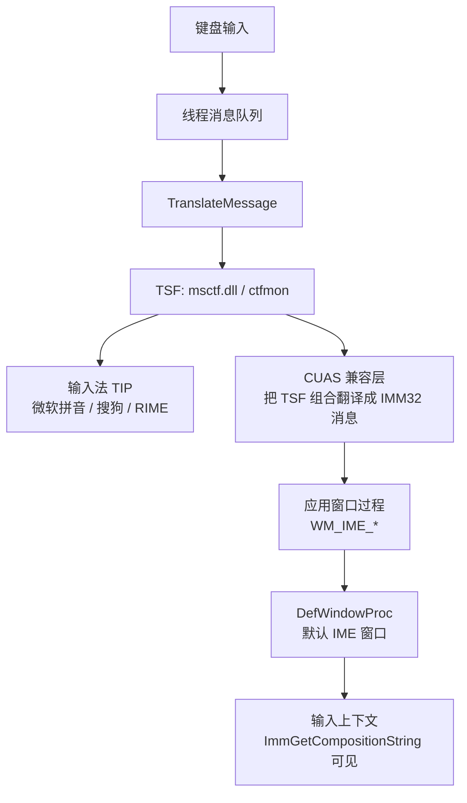

# Windows 输入法内联组合串调研（issue #6）

- 状态：已定位，代码已修复，输入法兼容性有边界
- 日期：2026-11-19
- 关联：issue #6「统一 IME 组合输入与文本编辑」、ADR 0003「输入法组合文本是真实缓冲区内容」

## 1. 结论摘要

1. 自绘输入框要显示内联拼音，**唯一的数据来源是 `WM_IME_COMPOSITION` 携带的 `GCS_COMPSTR`**；`GCS_RESULTSTR` 只有上屏结果，补不出组合过程。
2. 组合串是否投递，**取决于输入法自己怎么实现 IMM32 兼容层**，不是应用能单方面决定的：
   - **微软拼音（系统自带）**：逐键投递 `GCS_COMPSTR | GCS_COMPATTR | GCS_COMPCLAUSE | GCS_CURSORPOS`，内联预编辑可以正常显示；
   - **搜狗拼音**：组合过程全部在它自己的窗口里，应用只收到最后一条 `GCS_RESULTSTR`，外加两条 `WM_IME_CHAR`。任何应用都拿不到它的组合串。
3. 我们这一侧同时补上了 IMM32 的消息契约（三条组合消息交还 `DefWindowProc`、交还后补读组合串、日志记录输入法名字）。微软拼音下内联预编辑已实测通过；搜狗下退回“输入法自带组合窗”，不显示内联拼音。
4. 不需要 TSF（`ITfThreadMgr` + `ITextStoreACP`）。Chrome / Firefox 走 TSF 是为了富文本与显示属性；Qt、winit、SDL 这类自绘框架走 IMM32 就够。

## 2. 问题与验收标准

**现象**：在展示程序的顶栏搜索框中输入拼音时，输入框内不显示正在组合的拼音（输入法的候选面板正常）。

**验收标准**：

- 组合期间，输入框内联显示组合串，带下划线，插入符位于组合串内的正确位置；
- 组合串参与水平滚动、选区与删除，而不是叠加在文本之上的一层“幽灵文字”；
- 上屏只插入一次，取消（`Esc`）不留残余；
- 焦点移出、窗口失焦时组合被取消；
- 不改变输入法自带候选面板的位置与行为。

## 3. 系统分层：IMM32、TSF 与 CUAS



- **IMM32**（`imm32.dll`）：Windows 95 时代的输入法管理器，用 `WM_IME_*` 消息 + `Imm*` API 暴露组合状态。
- **TSF**（`msctf.dll`，代号 Cicero）：Vista 之后的主线。输入法变成 COM 组件（TIP），通过 `ITfKeyEventSink` 在按键到达应用之前截获，通过 `ITfContext` / `ITextStoreACP` 与应用交换文本。
- **CUAS**（Cicero Unaware Application Support）：TSF 的兼容层。应用没有创建 `ITfThreadMgr`（TSF-unaware）时，CUAS 假装成 IMM32，把 TIP 的组合过程翻译成 `WM_IME_*`，并在输入上下文里维护一份 **IMM32 组合镜像**。`ImmGetCompositionString` 读到的就是这份镜像。

关键推论：

1. 我们是 TSF-unaware 的 IMM32 应用，**组合串只能来自 CUAS 的镜像**。
2. 镜像由输入法（TIP）决定要不要写、什么时候写。**有的输入法根本不写**，只在提交时给结果。
3. 候选面板由输入法自己绘制，与镜像无关。所以“面板正常、组合串为空”是自洽的，不能据此认为输入法工作正常。

## 4. 生态调研

| 项目 | 路线 | 组合串来源 | 备注 |
| --- | --- | --- | --- |
| Chromium | TSF | `ITextStoreACP` + `ITfContextOwnerCompositionSink` | `ui/base/ime/win/tsf_text_store.cc`、`ime_tsf_win.cc` |
| Firefox | TSF | `TSFTextStore` | 早期用 IMM32，2017 年后统一切到 TSF |
| Qt 5/6 | IMM32 | `QWindowsInputContext` 读 `GCS_COMPSTR`，发 `QInputMethodEvent` | 同一个上下文负责 `ImmSetCompositionWindow` / `ImmSetCandidateWindow` |
| winit | IMM32 | `WM_IME_COMPOSITION` 里读 `GCS_COMPSTR`，转 `Ime::Preedit` | |
| SDL2/SDL3 | IMM32 | `WIN_IME` 事件 | |
| 游戏 / 自绘引擎（CEGUI、Unity、Unreal） | IMM32 或 TSF | 多为 IMM32，自绘组合串 | 常见坑就是本文这一条 |

Rust 生态没有可直接复用的库：`winit` 的 IME 支持与它自己的事件循环强耦合；`imekit` / `ime-rs` 是**实现输入法**的库，不是接输入法用的；`egui` / `iced` / `slint` 各自包一层 winit 或平台 API。

## 5. 我们的设计约束（ADR 0003）

- 组合串写入**真实编辑缓冲区**，记录它占据的字节区间；平台层只上报“组合串 + 选区 + 启用状态”，不缓存待提交文本、不提供轮询通道。
- 提交是“用提交串替换组合区间”，因此天然不会重复插入。
- 任何新增自绘输入框复用同一套编辑核心，不再引入第二份“预编辑文本”。

平台事件只有四种：`Preedit(text, selection)`、`Commit(text)`、`Enabled`、`Disabled`。

## 6. 实现（修复后）

`crates/unbound-platform/src/backend.rs` 的 `wnd_proc`：

| 消息 | 处理 |
| --- | --- |
| `WM_IME_SETCONTEXT` | 记录日志后透传 `DefWindowProc`（不清 `ISC_SHOWUICOMPOSITIONWINDOW`，见第 9 节） |
| `WM_IME_STARTCOMPOSITION` | 重报组合窗位置、发 `Enabled`、读一次组合串，**透传** |
| `WM_IME_COMPOSITION` | 读 `GCS_RESULTSTR` 发 `Commit`、读 `GCS_COMPSTR`+`GCS_CURSORPOS` 发 `Preedit`，**透传后再补读一次** |
| `WM_IME_ENDCOMPOSITION` | 发 `Disabled`、清残留预编辑，**透传** |
| `WM_IME_NOTIFY` | 读一次组合串兜底，透传 |
| `WM_IME_REQUEST` | 回答 `IMR_QUERYCHARPOSITION`（候选窗锚定） |
| `VK_PROCESSKEY` | 读一次组合串兜底 |

两处关键修正：

1. **三条组合消息不再吞掉**。MSDN 明确写了：不自绘组合串的窗口必须把 `WM_IME_COMPOSITION` 交给 `DefWindowProc`，由默认 IME 窗口更新状态。
2. **交还之后再补读一次组合串**。组合串有可能是在默认 IME 窗口处理过程中才写进输入上下文的；补读的结果与已有预编辑去重，不会重复推送。

另外，`WM_IME_CHAR`（`0x0286`）必须忽略：`DefWindowProc` 会把它翻译成 `WM_CHAR`，我们两条都不进文本，否则搜狗这类“上屏后补发 `WM_IME_CHAR`”的输入法会重复插入。

## 7. 实测证据

### 7.1 微软拼音：组合串完整

```text
ime start ime="..." caret=Some((596, 44, 18))   # 首字段是 ImmGetDescriptionW 返回的输入法名
ime composition flags=0x000001B8          # COMPSTR|COMPATTR|COMPCLAUSE|CURSORPOS|DELTASTART
ime preedit "n"
ime preedit "ni"
ime preedit "ni'h"                        # 微软拼音的音节分隔符，与系统候选窗显示一致
ime preedit "ni'ha"
ime preedit "ni'hao"
ime composition flags=0x00001C00          # RESULTSTR|RESULTREADSTR|RESULTCLAUSE
ime result "你好"
ime end
```

`ImmGetCompositionStringW(GCS_COMPSTR)` 在两次组合中分别轮询到 `n / ni / ni'h / ni'ha / ni'hao`，与逐键输入一一对应。

### 7.2 搜狗拼音：只有结果串

```text
ime start ime="..." caret=Some((574, 44, 18))
ime sync himc=true comp="" cursor=0       # 组合全程轮询，全部为空
ime msg=0x0288 wparam=0x6                 # 反复询问插入符位置（它想自己画）
ime composition flags=0x00000800          # 只有 RESULTSTR
ime result "你好"
ime msg=0x0286 wparam=0x4F60              # WM_IME_CHAR 补发“你”
ime msg=0x0286 wparam=0x597D              # WM_IME_CHAR 补发“好”
ime end
```

同一次运行、同一个二进制、同一个窗口：微软拼音给组合串，搜狗不给。**差异在输入法实现，不在应用。**

### 7.3 修复前的日志（对照）

修复前（当时用的是搜狗）同样是 `comp=""`、`flags=0x800`，但当时把原因归到了“消息被吞”。修复后搜狗的表现没有变化——这条反证说明：**搜狗的组合串从来没进过 IMM32 镜像**，应用侧怎么改都拿不到。

## 8. 根因

**输入法没有实现 IMM32 组合镜像的上报，应用侧无解。**

- 微软拼音走 CUAS 的“镜像”路径：每次组合变化都写输入上下文，并发 `WM_IME_COMPOSITION`。
- 搜狗走“自带 UI”路径：组合状态只存在于它自己的窗口，IMM32 上下文始终为空；上屏时才把结果串交给应用。它甚至不区分应用是否自绘，`IMR_QUERYCHARPOSITION` 只是用来摆自己的候选窗。

我们这一侧原来的实现还有两个真实缺陷，会在“愿意投递组合串的输入法”上直接失效，已一并修掉：

- 三条组合消息全部 `return 0`，默认 IME 窗口拿不到消息，违反 MSDN 的消息契约；
- 只在消息处理前读组合串，漏掉“默认窗口处理时才写入上下文”的时序。

## 9. 兼容性策略

| 输入法 | 组合串 | 内联预编辑 | 组合期可见性 |
| --- | --- | --- | --- |
| 微软拼音 | 有（`0x1B8`） | 应用自绘，带下划线 | 输入框内 |
| 搜狗拼音 | 无 | 不可用 | 输入法自带浮窗 |
| 其他第三方（QQ、RIME 等） | 待测 | 取决于实现 | 取决于实现 |

因此**不清除 `ISC_SHOWUICOMPOSITIONWINDOW`**：

- 清掉它等于告诉系统“组合串由应用画”。对搜狗这类不给组合串的输入法，结果是**哪儿都不显示**，比现在更差；
- 保留它，微软拼音下输入框内联显示、候选窗照常；搜狗下浮窗照常。两类用户都不至于“看不见自己打了什么”。

代价是微软拼音可能同时显示浮窗与内联文本（是否重复取决于输入法自己的判断），需要在真机上继续观察；若确认重复，再按输入法名字分流（`ImmGetDescriptionW` 已经在诊断日志里）。

## 10. 备选方案（记录在案）

| 方案 | 做法 | 结论 |
| --- | --- | --- |
| B. 完全交给输入法绘制 | 不清标志、消息全部透传 | 组合串画不进输入框，不满足验收标准 |
| C. TSF（`ITextStoreACP`） | 实现文本存储、选区、edit session、组合视图 | 能力最全，但工作量大一个数量级；当前不需要 |
| D. 自己记按键拼组合串 | 拦截字母键自建拼音缓冲 | 与输入法状态机打架（候选、翻页、双拼、五笔全错），ADR 0003 明确禁止 |

## 11. 后续

- **显示属性**：`GCS_COMPATTR` 已随消息到达，但当前只用单一下划线。后续可把 `ATTR_TARGET_CONVERTED` / `ATTR_TARGET_NOTCONVERTED` 映射成“已转换段 / 未转换段”，与系统输入法一致。
- **输入法分流**（可选）：如果微软拼音确实出现“浮窗 + 内联”双份，可按 `ImmGetDescriptionW` 的结果决定是否清 `ISC_SHOWUICOMPOSITIONWINDOW`。
- **第三方输入法**：搜狗类实现属于对方兼容层缺失，应用侧没有可靠的绕法；如果产品必须覆盖，只能上 TSF（方案 C）。

## 12. 参考

- MSDN：`WM_IME_COMPOSITION`（Remarks：不自绘的窗口必须把消息交给 `DefWindowProc`）
- MSDN：`WM_IME_SETCONTEXT`（自绘组合窗要在 `lParam` 上清 `ISC_SHOWUICOMPOSITIONWINDOW`）
- MSDN：`ImmGetCompositionString`、`GCS_COMPATTR`、`ATTR_TARGET_CONVERTED`
- Chromium：`ui/base/ime/win/tsf_text_store.cc`、`ui/base/ime/win/ime_tsf_win.cc`
- Qt：`src/plugins/platforms/windows/qwindowsinputcontext.cpp`
- winit：`src/platform_impl/windows/event_loop.rs`（`WM_IME_COMPOSITION` 分支）
